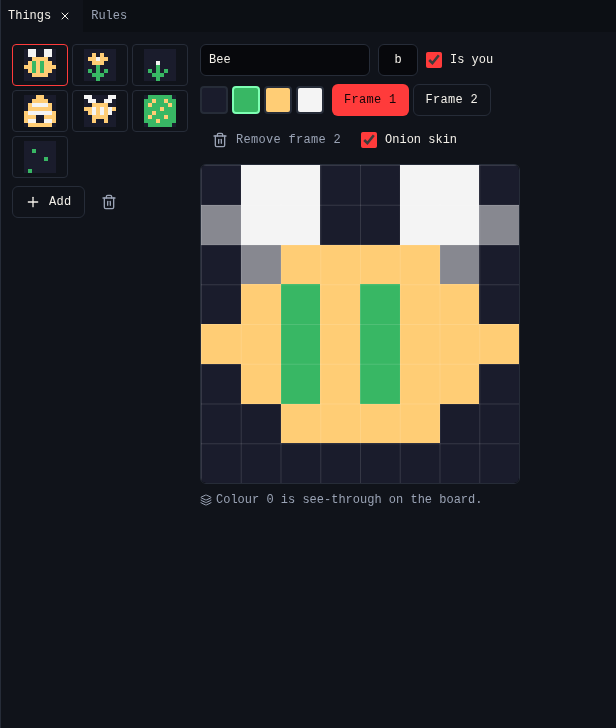
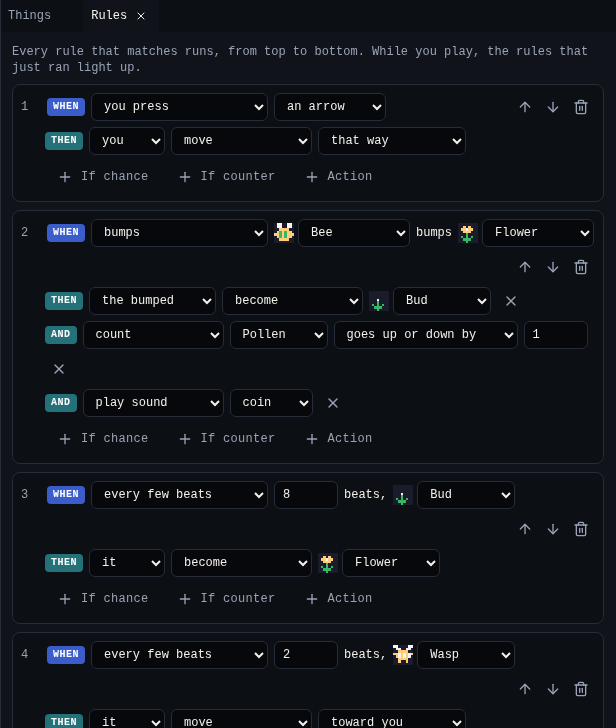
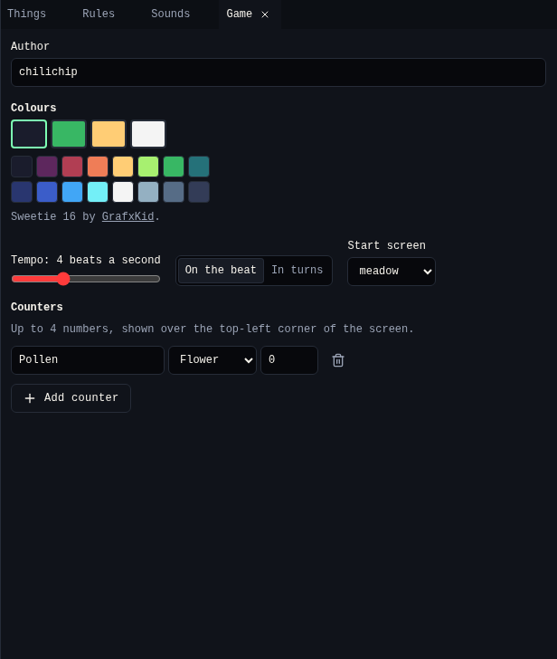

# Chili Beat

!!! warning "Not on for everyone yet"
    Add `?engines=beat` to the creator's address to try Chili Beat. Games you
    make now keep working when it ships.

Chili Beat is the second kind of game you can make in the creator, next to
Bitsy. Everything on the screen is a *thing*. When a thing moves into a cell
that is full, it *bumps* what is there, and your rules decide what happens.
The world moves on a steady beat, and the music plays on the same beat.

{ .shot }

| Idea | In short |
|---|---|
| One screen | A 16 × 16 board of 8 × 8 cells. Walk off an edge to the next screen. |
| Four colours | Each game picks 4 colours from the Sweetie 16 palette. |
| Everything is a thing | Heroes, walls, coins and enemies. One per cell, on top of a ground picture. |
| One verb: bump | Moving into a full cell bumps what is there. With no rule, it acts as a wall. |
| Time is a beat | 2 to 8 beats a second. Or turns: the world moves only when you do. |
| Rules are cards | *When* something happens, *If* something is true, *Then* do something. |

The engine, its file format and every rule are documented in the
[Chili Beat docs](https://github.com/chili-chip/chili-beat/tree/main/docs).

## Start a game

In **Projects**, press **New game**. Pick **Chili Beat** for a blank game, or
start from **Bee Home**, **Crate Puzzle** or **Garden Toy**.

{ .shot }

A blank game has a hero in a walled room and one rule: *When you press an
arrow, you move that way.* The [Bee Home tutorial](tutorial.md) builds a whole
game from there.

## Tools

A Chili Beat game has its own tools. Projects, undo, autosave and the title
work as they do for Bitsy games.

### Screens

{ .shot }

| Part | What it does |
|---|---|
| **Things** / **Ground** | The layer you paint. Things block and bump. Ground is only a picture under them. |
| Brushes | Pick a thing to paint with, or the eraser. |
| Board | Click or drag to paint cells. |
| World map | The 8 × 8 squares on the right. Click a screen to edit it, or an empty square to add one. ★ marks the start screen. |
| **Screen name** | Used by *go to screen* cards. |
| **Tune** | The tune that plays on this screen. |
| **Reset when you come back** | Off: the screen stays as you left it. On: it starts fresh each time. |
| **Start here** | Makes this the screen the game starts on. |

### Things

{ .shot }

| Part | What it does |
|---|---|
| List | Every thing in the game. **Add** makes a new one. |
| Name, **Key** | The name shows on cards. The key is the one character the file uses for it. |
| **Is you** | The player moves things that are "you". Several kinds can be. |
| Colours | The game's 4 colours. Colour 0 is see-through on the board. |
| **Frame 1** / **Frame 2** | With 2 frames, the thing flips between them on every beat. **Onion skin** shows the other frame faintly. |
| Drawing | Click or drag to draw 8 × 8 pixels. |

### Rules

{ .shot }

Each card is one rule. Every card that matches runs, from top to bottom, so the
arrows on a card move it up or down.

| Part | Choices |
|---|---|
| **When** | you press a button, a thing bumps another, every few beats, the screen starts, a counter reaches a number |
| **If** (up to 2) | a 1 in N chance, a counter is at least / at most / exactly a number |
| **Then** (up to 6) | move, turn, become, vanish, make, count, say, play sound, go to screen, shake, win, lose |
| Who | Which thing an action changes: you, the bumper, the bumped thing, or "it" in beat cards |

**Add a recipe** adds ready-made cards, and the things and counters they need:

| Recipe | Adds |
|---|---|
| Pick-up | A Coin and a Coins counter. Bump a coin: it vanishes and Coins goes up. |
| Push | A Crate that moves when you bump it. |
| Door and key | A Key, a Door and a Keys counter. A key opens one door. |
| Chaser | A Wasp that moves toward you every 2 beats. You lose when it reaches you. |
| Wanderer | A Cat that walks at random. |
| Talker | An Owl that says "Hoo!" when you bump it. |
| Goal | A Flag. Bump it to win. |
| Spreader | Fire that grows into empty cells. |
| Timer | A Time counter from 30 that goes down every 4 beats. You lose at 0. |

### Sounds

{ .shot }

| Part | What it does |
|---|---|
| Sound effects | A preset (coin, jump, hit, boom, step, power, blip) and **Pitch**, **Length** and **Slide**. ▶ plays it. *Play sound* cards use them. |
| **Tunes** | Pick a tune or **Add tune**. Pick its scale. |
| Melody | 16 steps, one per beat. Click a note to set it, click it again for a rest. |
| Bass and drums | The same, with bass notes, kick, snare and hi-hat. |
| **Play tune** | Plays it at the game's tempo. |

Notes come from the scale, so any pattern stays in key. Give a screen its tune
in **Screens**.

### Play

{ .shot }

Press **Play game**. Arrows or WASD move, ++z++ or ++space++ is A, ++x++ is B,
and the buttons under the screen work on touch screens. While it runs, the
cards that just ran light up in **Rules**. **Restart with my changes** plays
your latest edits. If the game has a mistake, Play says where, for example
`rules[1].do[0].become: no thing has key "z"`.

Play uses the same engine as the platform and the console, so the game plays
the same everywhere.

### Problems

{ .shot }

| Level | Checks |
|---|---|
| Error | Nothing on the start screen is "you". A card uses a thing, counter, sound or screen that was deleted. |
| Warning | A card has no actions. |
| Note | No card wins or loses (fine for a toy). A screen can't be reached. |

The status bar shows the count of errors and warnings.

### Game

{ .shot }

| Part | What it does |
|---|---|
| **Author** | Your name, saved in the game. |
| Colours | Click one of the 4 game colours, then a colour from Sweetie 16. Colour 0 is the background. |
| **Tempo** | Beats a second, 2 to 8. |
| **On the beat** / **In turns** | On the beat: the world moves all the time. In turns: only after each button press. |
| **Start screen** | Where the game starts. |
| **Counters** | Up to 4 numbers, shown over the top-left corner of the screen. Each has a name, a thing as its icon and a start value. |

## Related

- [Bee Home tutorial](tutorial.md)
- [Projects](../tools/projects.md)
- [Credits and licences](../reference/credits.md)
