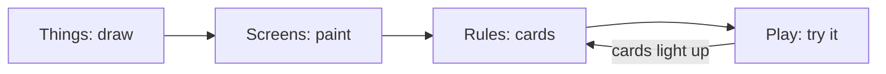

# Chili Beat editor

!!! warning "In progress"
    Chili Beat is not on for everyone yet. Add `?engines=beat` to the creator's
    address to try it. Games you make now keep working when it ships.

Chili Beat is a second kind of game you can make in the creator. Things bump,
move and change on the beat, and rules are cards you build from pictures. The
engine, its file format and its rules are documented in the
[Chili Beat docs](https://github.com/chili-chip/chili-beat/tree/main/docs).

## Make a game

1. In **Projects**, press **New game** and pick **Chili Beat**.
2. The game starts with a hero in a walled room and one rule:
   *When you press an arrow, you move that way.*
3. Draw things in **Things**, paint them on **Screens**, and add cards in **Rules**.
4. Press **Play** to try it. The rule cards that just ran light up.

## Tools

| Tool | What you do there |
|------|-------------------|
| **Screens** | Paint things on the **Things** layer and pictures on the **Ground** layer of a 16 × 16 screen. Pick a thing as the brush, or the eraser. The 8 × 8 map on the right picks a screen, and an empty square adds one. Name the screen, give it a tune, and choose whether it resets when you come back. **Start here** makes it the start screen. |
| **Things** | Draw each thing in 8 × 8 pixels with the game's 4 colours. Colour 0 is see-through on the board. Add a second frame to animate it on the beat, with onion skin to see the other frame. Set its name, its one-character key, and whether it **is you**. |
| **Rules** | One card per rule: **When** a trigger, **If** up to 2 conditions, **Then** up to 6 actions. Pick every part from a list; things show their picture. Arrows reorder cards, because they run from top to bottom. |
| **Play** | Plays the game with the real engine, the same one the platform and the console use. If the game has a mistake, it says where. Arrows or WASD move, Z or Space is A, X is B. Touch buttons work on phones. |
| **Game** | The 4 colours from the Sweetie 16 palette (by GrafxKid), the tempo (2 to 8 beats a second), beat or turns, the start screen and up to 4 counters. |

Undo, autosave, the title and Projects work as they do for Bitsy games.

## Coming next

The **Sounds** tool (blips and tunes), the **Recipes** menu on Rules (pick-up,
push, door and key, chaser and more), more templates, and checks in
**Problems**. See
[chili-beat#8](https://github.com/chili-chip/chili-beat/issues/8).
