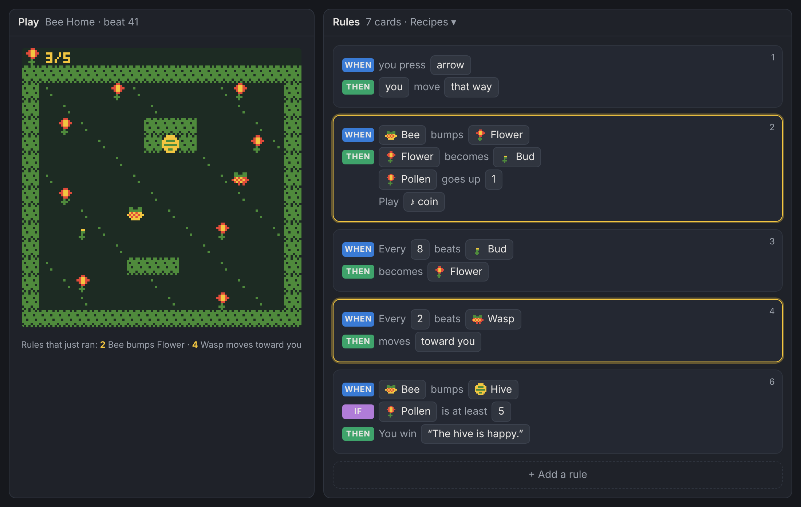
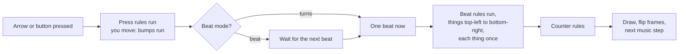
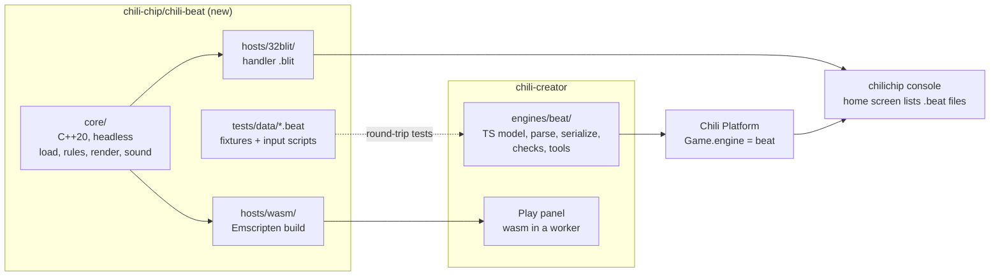

# Plan: the Chili Beat engine

!!! info "Status"
    Proposal, 2026-10-30. Nothing here is built yet. "Chili Beat" and `.beat` are working names. The creator side depends on [Plan: engines and editors](engines-plan.md).

Chili Beat is a new game engine with a no-code editor. The mechanics and graphics are tiny on purpose, so a first game takes ten minutes. The rules are few but combine well, so the same pieces make a puzzle, a chase, a garden that grows, a story walk or a rhythm game.

It runs the same games in the browser and on the chilichip console.



*Mockup, not a screenshot. The example game is [Bee Home](#example-bee-home).*

## The six ideas

Everything in the engine comes from these six ideas. If a feature needs a seventh, it does not go in.

| # | Idea | In one line |
|---|---|---|
| 1 | **One screen, one grid** | The screen is 128 × 128 pixels: a 16 × 15 board of 8 × 8 cells, and one bar row on top for counters. |
| 2 | **Four colours** | A game picks 4 colours from the 16-colour chilichip palette. Colour 0 is the background. |
| 3 | **Everything is a thing** | Heroes, walls, coins, doors, enemies, signs: all are things. Each cell holds at most one thing, on top of a ground picture. |
| 4 | **One verb: bump** | When a thing moves into a cell that is not empty, it **bumps** what is there. Rules decide what happens. With no rule, the cell blocks it like a wall. |
| 5 | **Time is a beat** | The world moves on a beat (a steady tick, 2 to 8 per second), and the music plays on the same beat. Or, in turn mode, the world moves only when you do. |
| 6 | **Rules are sentences** | "When Bee bumps Flower, Flower becomes Bud and Pollen goes up 1." Rules are cards picked from pictures. No code, no typing except names and text. |

Why bump: one mechanic covers walls (no rule), pick-ups (the other thing vanishes, so the cell is free and you move in), pushing (the other thing moves the same way first), doors, keys, talking, enemies and goals. People learn one thing and then combine it.

Why a beat: it makes things move without any physics. It also ties the music to the game, so even simple games feel alive. A single setting flips between action (beat) and puzzle (turns).

## What a game is made of

| Part | What it is | Limit |
|---|---|---|
| **Palette** | 4 colours from the 16-colour chilichip palette | 4 |
| **Thing kinds** | A name, a one-letter key, an 8 × 8 picture with 2 frames (in 4 colours, colour 0 is see-through), and one switch: **is you** | 64 |
| **Ground** | Pictures drawn under things. They never block and never bump. They are thing kinds used as ground. | (same 64) |
| **Screens** | A 16 × 15 board of things and a 16 × 15 ground. Screens sit on an 8 × 8 map; walking off an edge goes to the neighbour. | 64 |
| **Counters** | A name, an icon, a start value. Shown in the bar on top. | 4 |
| **Rules** | When ..., if ..., then ... | 128 rules, 6 actions each |
| **Blips** | Short sound effects made from a preset and 3 sliders | 16 |
| **Tunes** | A 16-step loop, 2 voices, notes from one scale | 8 |
| **Settings** | Title, author, tempo, beat or turns, start screen | |

A whole game is a few kilobytes. Every limit fits easily in the console's memory.

### Pictures

Each thing has 2 frames of 8 × 8 pixels, 2 bits per pixel. The frame flips on every beat, so anything with 2 different frames animates by itself. A thing's picture faces one way; the engine does not rotate or flip it (simple, and it keeps pixel art as drawn).

When a thing moves, it slides from cell to cell over a quarter of a beat. Only the drawing slides: in the rules, the thing is in the new cell at once.

### "You"

Any thing kind can be **you**. Arrow keys move every thing that is you. Several things can be you at once (move two heroes together), and a rule can turn you into something else ("Bee becomes Bear"), which changes who you are. If nothing on the screen is you, the game waits for rules (a cut scene) or is over.

## Rules

A rule is one card:

```text
WHEN  <trigger>
IF    <condition>          (optional, up to 2)
THEN  <action>             (1 to 6)
```

All rules whose trigger and conditions match run, from top to bottom. Order matters only when two rules touch the same thing, and the list shows the order.

### Triggers

| Trigger | Card text | Runs |
|---|---|---|
| Start | When the screen starts | Once, when you enter the screen |
| Press | When you press **A** / **B** / an arrow | At the press |
| Bump | When **X** bumps **Y** | When a thing of kind X moves into a cell with a thing of kind Y. X or Y can be "you" or "anything". |
| Beat | Every **N** beats, **X** ... | For each X on the screen, every N beats (N = 1 to 16) |
| Counter | When **Counter** reaches **N** | Once, when the counter becomes N |

Every new game starts with one rule already in the list: **When you press an arrow, you move that way.** It is a normal rule. Delete it for a one-button game, or change it ("you turn that way") for a tank game.

### Conditions

| Condition | Card text |
|---|---|
| Chance | 1 in **N** chance |
| Counter | **Counter** is at least / at most / exactly **N** |

### Actions

In a bump rule, actions pick **the bumper** (X) or **the bumped** (Y). In other rules they act on the thing the rule is about.

| Action | Card text | Notes |
|---|---|---|
| Move | ... moves **up / down / left / right / forward / back / same way / toward you / away from you / at random** | Moving can bump again, so pushes chain. "Same way" is the bumper's direction. "Forward" is the way the thing last moved. |
| Turn | ... turns **direction** | Changes "forward" without moving |
| Become | ... becomes **Kind** | Keeps place and direction |
| Vanish | ... vanishes | Frees the cell |
| Make | ... makes **Kind** to its **side** | Only into an empty cell |
| Count | **Counter** goes up / down **N**, or is set to **N** | |
| Say | Say "**text**" | Up to 64 characters. The game pauses until A is pressed. |
| Sound | Play **Blip** | |
| Go | Go to screen **S** | You appear where you were, if the cell is free |
| Shake | Shake the screen | For one beat |
| Win / Lose | You win / You lose, with a line of text | Shows the text, then A restarts the game |

That is 5 triggers, 2 conditions and 11 actions. Nothing else.

### How a beat runs



The rules are exact, so a game always plays the same way with the same buttons and the same random seed. That is what makes the engine easy to test.

- The list of things is taken at the start of a beat. A thing made during the beat waits for the next one.
- A thing moves at most once per beat from beat rules (so a fast "every beat, move right" thing does not cross the screen in one beat when scanned left to right).
- A bump can cause more bumps. The chain stops after 16, so two rules cannot loop forever.
- Holding an arrow repeats the move on each beat. In beat mode the first press moves at once, so control feels quick.

### Moving between screens

When you walk off an edge and a screen is next to this one on the map, you go there and appear at the opposite edge. If that cell is full, you bump what is there; if it does not let you in, you stay. Other things stop at edges. Screens keep their state when you leave. A screen setting, **Reset when you come back**, restores it to how it was drawn (for puzzle rooms).

## Sound and music

The console plays square, noise and other simple waves on 8 channels. The engine uses 2 for music and 2 for blips. The web player makes the same sounds.

**Blips.** Pick a preset (coin, jump, hit, boom, step, power, blip), then move 3 sliders: pitch, length, slide. The editor plays it at once.

**Tunes.** A 16-step grid with 2 voices: a lead and a beat (bass and noise drums). You choose a scale (major, minor, or one of two pentatonics) and only notes in the scale can be placed, so anything you click sounds fine. The tune moves one step per beat, so the music and the game share the same tempo. Each screen picks a tune, or none.

## Text

A "Say" or "Win/Lose" opens a box at the bottom: 3 lines of 20 characters in a 6 × 8 font. Longer text pages on A. The font is drawn new for chilichip (no Bitsy font), so its licence is ours.

## Example: Bee Home

A small game that shows most of the engine. Pollen from flowers, a wasp that chases, a hive to finish.

| Key | Thing | Is you |
|---|---|---|
| `b` | Bee | yes |
| `f` | Flower | |
| `u` | Bud | |
| `w` | Wasp | |
| `h` | Hive | |
| `#` | Hedge | |

Rules, as the editor shows them:

1. When you press an arrow, you move that way.
2. When Bee bumps Flower: Flower becomes Bud. Pollen goes up 1. Play *coin*.
3. Every 8 beats, Bud becomes Flower.
4. Every 2 beats, Wasp moves toward you.
5. When Wasp bumps Bee: Shake the screen. You lose "Stung! Try again."
6. When Bee bumps Hive, if Pollen is at least 5: You win "The hive is happy."
7. When Bee bumps Hive, if Pollen is at most 4: Say "Bring me 5 pollen."

Hedge has no rules, so it is a wall. Seven cards make a full game.

## More games from the same pieces

These are not built in. They show how far the six ideas go. Each one is a handful of rules.

| Game idea | The trick |
|---|---|
| **Crate puzzle** (turn mode) | When you bump Crate: Crate moves same way. When Crate bumps Hole: Hole vanishes, Crate becomes Floor-stone. |
| **Chain push** | Add: When Crate bumps Crate: the bumped moves same way. Now rows of crates push. |
| **Spreading fire** | Every beat, Fire makes Fire at random side, 1 in 4 chance. Every 6 beats, Fire becomes Ash. When you bump Water: you become Wet-you. When Wet-you bumps Fire: Fire vanishes. |
| **Trail game** | Every beat, you move forward and make Tail behind. Every 6 beats, Tail vanishes. When you bump Tail: you lose. Arrows turn instead of move. |
| **Garden** (no ending) | Seed every 8 beats becomes Sprout, Sprout becomes Flower, 1 in 3 chance. A toy, not a game, and that is fine. |
| **Story walk** | Many screens, people who Say things when bumped, a counter for what you know, doors that open when the counter is high enough. |
| **One-button dodge** | Delete the arrow rule. When you press A: you move up. Every beat, you move down. Rocks every beat move left. |
| **Shape shifter** | When you press B: Bee becomes Mole, Mole becomes Bee. Mole can bump Dirt to dig; Bee can cross Water. |

## The editor

The Chili Beat editor is one editor module for the creator (see [Plan: engines and editors](engines-plan.md)). It uses the shell's Projects, Play, Problems and Download, plus these tools:

| Tool | What you do there |
|---|---|
| **Things** | The list of thing kinds. Draw each one: 8 × 8, 4 colours, 2 frames, onion skin of the other frame. Name, key, "is you". |
| **Screens** | Paint things and ground on the board with the picked thing. The map of screens (8 × 8) to add, move and pick screens. Tune and reset setting per screen. |
| **Rules** | The rule cards. Each slot is a button that opens a picker with pictures. Drag to reorder. A **Recipes** menu adds ready-made cards (pick-up, push, door and key, chaser, wanderer, talker, goal, spreader, timer). |
| **Sounds** | Blips: preset and 3 sliders. Tunes: the 16-step grid. |
| **Game** | Title, palette, tempo, beat or turns, counters, start screen. |

The **Play** panel adds a rule trace while playing: the cards that just ran light up in the Rules tool. This is how people learn what their rules do, without a debugger.

Layout presets: **Draw** (Things + Screens), **Rules** (Rules + Play), **Sound** (Sounds + Play).

### Checks (Problems)

| Check | Level |
|---|---|
| No thing that is you on the start screen | Error |
| A rule uses a thing kind or counter that was deleted | Error |
| A rule has no actions | Warning |
| There is no Win or Lose rule | Info (toys are allowed) |
| A screen cannot be reached | Info |

### Templates

| Template | What is in it |
|---|---|
| Blank | One screen, a hero that is you, the arrow rule |
| Bee Home | The example above |
| Crate puzzle | Turn mode, 3 small screens |
| Garden toy | A screen of seeds, no ending |

## How it is built



| Choice | Why |
|---|---|
| **One C++ core** for web and console | Same game, same behaviour everywhere. The pattern already works for citsy. |
| **One repo** with core and both hosts in folders | Fewer repos and one pull request per change. CMake targets keep the core headless (no 32blit or SDL in `core/`), like citsy's rules. |
| **Console player is a handler app** | The home screen already lists files for apps with `category: handler` and `filetypes`. The app lists `beat`; `.beat` files on the CHILICHIP drive (or a `beat-games/` folder) show up as games. No OS change. |
| **The editor model is TypeScript** in the creator | The editor needs the data, not the simulation. Play uses the wasm core. |
| **JSON file format** | The platform stores game data as text (1.5 MB cap). JSON is easy to read, diff and check. On the console a small JSON reader is enough. |
| **Integer-only, seeded random** | Exact replays for tests. Same result on wasm and RP2350. |

### Core interface

Like citsy: the engine never draws, it fills memory and the host shows it.

```cpp
namespace beat {

enum class Button { Up, Down, Left, Right, A, B, Menu };

class Host {
 public:
  virtual ~Host() = default;
  virtual double delta_time_ms() const = 0;
  virtual bool button(Button b) const = 0;
  // 128x128 colour indices 0-3, the 4 palette colours as RGB,
  // and up to 4 sound channels.
  virtual void present(const Frame& frame) = 0;
};

class Engine {
 public:
  static std::expected<Engine, LoadError> load(std::string_view json, uint32_t seed);
  void update(Host& host);      // fixed 60 Hz steps inside
  const Debug& debug() const;   // counters, beat number, rules that ran
};

}  // namespace beat
```

### File format

One JSON file, `.beat`. Maps are text, one character per cell (the thing's key, `.` for empty), so a diff shows what moved.

```json
{
  "format": "chili-beat",
  "version": 1,
  "title": "Bee Home",
  "author": "",
  "palette": [0, 9, 11, 14],
  "tempo": 4,
  "time": "beat",
  "start": "meadow",
  "counters": [{ "id": "pollen", "name": "Pollen", "icon": "f", "start": 0 }],
  "things": [
    { "key": "b", "name": "Bee", "you": true,
      "frames": [["00111100", "01222210", "..."], ["..."]] },
    { "key": "f", "name": "Flower", "frames": [["..."], ["..."]] }
  ],
  "screens": [
    { "id": "meadow", "map": [0, 0], "tune": "main", "reset": false,
      "things": ["################", "#b....f.....f..#", "..."],
      "ground": ["................", "..."] }
  ],
  "rules": [
    { "when": { "bump": ["b", "f"] },
      "do": [
        { "become": "u", "who": "bumped" },
        { "count": "pollen", "add": 1 },
        { "sound": "coin" }
      ] }
  ],
  "blips": [{ "id": "coin", "preset": "coin", "pitch": 6, "length": 3, "slide": 2 }],
  "tunes": [{ "id": "main", "scale": "pentatonic", "lead": [0, 2, 4, -1], "beat": [1, 0, 2, 0] }]
}
```

The exact schema is the first deliverable (see M0). The engine repo keeps it in `format/schema.json` and the creator tests against the engine's fixtures.

## Milestones

| # | Milestone | Repo | Done when |
|---|---|---|---|
| M0 | Format v1 spec and fixtures, final name | chili-beat | Schema, 5 fixture games, this plan reviewed |
| M1 | Core: load, board, you move, bump blocks, render | chili-beat | MockHost tests: frames and state after an input script |
| M2 | Rules: all triggers, conditions and actions; counters; screens; say; win and lose | chili-beat | One fixture per rule type plus Bee Home replays |
| M3 | Sound: blips and tunes on the beat | chili-beat | Tests on channel values per beat |
| M4 | Hosts: wasm for the web, handler `.blit` for the console | chili-beat | Node test runs the wasm; Bee Home plays on the console |
| M5 | Editor: Things, Screens, Rules, Game, Play with rule trace | chili-creator | Needs engines plan steps 2 to 6. Unit, round-trip and E2E tests |
| M6 | Editor: Sounds, recipes, templates, checks | chili-creator | Component tests; E2E makes Bee Home from Blank |
| M7 | Ship: platform engine field live, `/play` uses the beat player, device sync serves `.beat`, docs and tutorial | all | A game made on the web plays on the console |

M1 to M4 can run while the creator does the engines plan. The two meet at M5.

## Tests

| Level | What |
|---|---|
| Unit (core) | Each trigger, condition and action on a small board, with MockHost. Beat order, bump chains and the 16-bump limit. |
| Fixtures (core) | `tests/data/*.beat` with an input script (`*.inputs`: frame and buttons) and the expected end state. The same seed gives the same result. |
| Round-trip (creator) | Parse and serialize every engine fixture byte for byte. |
| wasm (creator) | Run the real wasm in Node, like `citsy.test.ts`. |
| End to end (creator) | Playwright: make a game from Blank, add a rule from Recipes, play it, win. |
| Console | Manual: install the handler `.blit`, copy Bee Home, play it, check sound. Listed in the PR. |

## Open questions

1. **Name.** "Chili Beat" and `.beat` are placeholders. The home screen matches the first 4 letters of the extension, so the name should not start with `bits` or `blit`.
2. **The 16-colour chilichip palette.** Proposal: take it from the brand kit Eli is making, so games match the console and the website.
3. **Saves.** Proposal: no saves in v1. Games are short. Add "save at this screen" later if people ask.
4. **One palette per game or per screen.** Proposal: per game in v1.
5. **Selling.** Chili Beat games go through the same marketplace as Bitsy games, with no change.
