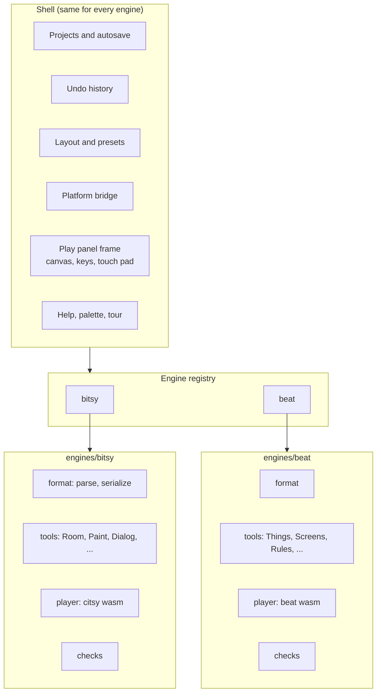
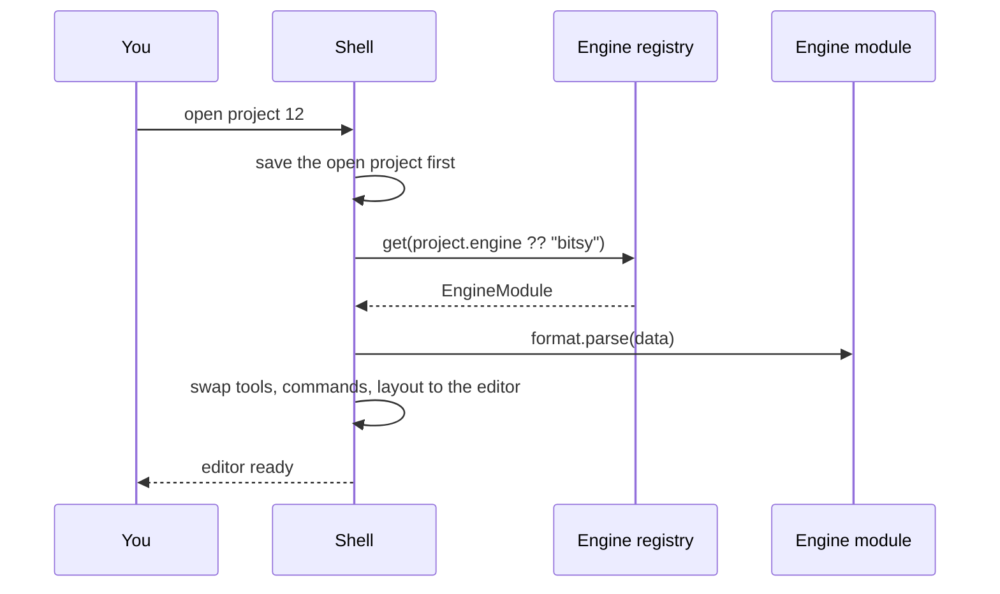

# Plan: engines and editors

!!! info "Status"
    Proposal, 2026-10-30. Nothing here is built yet. The new engine this makes room for is planned in [Plan: the Chili Beat engine](beat-engine-plan.md).

Today the creator makes Bitsy games only. This plan turns Bitsy into one **engine module** and lets the creator host more. Each project belongs to one engine. Opening a project loads its engine and its editor. A new game starts by picking an engine.

## Goals

- Add a new engine without touching the shell or the Bitsy code.
- One project = one engine. The engine is saved with the project.
- An engine can have more than one **editor** (a set of tools and a layout), and you can switch between them on the same project.
- The platform, the web player and the console know which engine a game uses.
- Old projects keep working: a project with no engine is a Bitsy project.

Not goals:

- Converting a game from one engine to another.
- Third-party engines loaded at run time. Engines are built into the creator, like tools are now.
- Many engines at once in one workspace.

## Words

| Word | Means | Example |
|---|---|---|
| **Engine** | Runs games of one format. Has a file format, a player and checks. | Bitsy (played by citsy), Chili Beat |
| **Editor** | The tools and layout used to make games for one engine. | "Bitsy creator" (Room, Paint, Dialog, ...) |
| **Engine module** | The code that adds one engine and its editors to the creator. | `app/src/engines/bitsy/` |
| **Document** | The open game, in the engine's own type. | Bitsy `World` |
| **Shell** | Everything that is the same for every engine: projects, saving, undo, layout, Help, the platform bridge. | `app/src/shell/` |

## Where we start

The plugin API already exists: tools and commands are registries (`app/src/plugin-api/`). But Bitsy is wired in below it:

| Place | Bitsy-specific today |
|---|---|
| `project/store.ts` | `OpenState` holds a `World`; open calls `parse`, save calls `serialize`; undo keeps `World[]` |
| `project/editor.ts` | Shared editor state is Bitsy's (room, drawing, dialog, exit, tune, blip) |
| `shell/App.tsx` | Calls Bitsy `validate` for the problem count |
| `player/` | Runs citsy in a worker; messages carry Bitsy text |
| `tools/*` | 15 tools, all built for Bitsy, about 40 imports of `bitsy/` |
| `export/` | HTML export packs the citsy web player |
| Platform `Game.data` | "Bitsy game source"; device sync serves `/api/device/games/{id}.bitsy` |
| Platform frontend `/play` | Always loads the citsy player |

The good news: the store already treats the document as a value that is replaced on every edit. Making that value generic is a small change.

## Architecture



Rules:

- The shell never imports an engine folder. It only knows the `EngineModule` type.
- Engine modules never import each other.
- Shared UI (`ui/`, the pixel canvas, the sound preview) stays shared. An engine may use it.

### The engine module

One file per engine exports this:

```ts
// app/src/plugin-api/engines.ts
export interface EngineModule<Doc = unknown> {
  /** Stable id, saved with every project. Never change it. */
  id: string;                    // "bitsy", "beat"
  title: string;                 // "Bitsy", "Chili Beat"
  description: string;           // one line for the New game picker
  icon: LucideIcon;

  format: {
    /** File extension for import, download and the console. */
    extension: string;           // ".bitsy", ".beat"
    /** True when a file is clearly this engine's, for import. */
    detect(text: string): boolean;
    parse(text: string): { doc: Doc; issues: Issue[] };
    serialize(doc: Doc): string;
  };

  /** Starting points for New game. The first one is the default. */
  templates: Template<Doc>[];

  /** One or more editors. The first one is the default. */
  editors: EditorDefinition[];

  /** Checks shown in Problems and run before release. */
  check(doc: Doc): Issue[];

  /** Plays the game in the Play panel and in exports. */
  createPlayer(options: PlayerOptions): Player;

  /** Extra downloads: HTML page, GIF, console file, ... */
  exporters?: Exporter<Doc>[];
}

export interface EditorDefinition {
  id: string;                    // "bitsy.classic"
  title: string;                 // "Bitsy creator"
  tools: ToolDefinition[];
  commands?: CommandDefinition[];
  presets: LayoutPreset[];       // Build, Write, Test, ...
}
```

`Player` is the interface the citsy player already has (`play`, `stop`, `button`, `subscribe`), made engine-neutral: the screen is any size, and engine-only state (Bitsy's inventory) goes through an optional `subscribeDebug`.

### What the shell keeps

| Shell part | Change |
|---|---|
| Project store | `OpenState` holds `{ engine, doc, issues }`. Open looks up the engine by the project's `engine`, then calls its `parse`. Save calls its `serialize`. Undo keeps `Doc[]`. |
| Autosave, revisions, 30 games, 1.5 MB | Unchanged. They work on text. |
| Workspace | When a project opens, the shell clears the tool registry and registers the editor's tools and commands. Layouts are saved per editor (`layout:<editor id>`). |
| Play panel | The panel frame, keys, gamepad and touch pad stay in the shell. The engine gives the `Player`. |
| Problems panel | Shows `engine.check(doc)`. |
| Projects tool | New game shows the engine picker (see below). Lists show an engine badge. Import uses `detect`. |
| Help and tour | Each tool keeps its own `help`. The tour gets one step per editor. |

Editor-only state (today's `project/editor.ts`) moves into `engines/bitsy/editor.ts`. Each engine keeps its own.

### Switching

There are two kinds of switch.

**Engine.** Follows the project. Open a Bitsy project and you get the Bitsy editor; open a Chili Beat project and you get that one. There is no "change engine" button, because a game cannot change format.



**Editor.** For the same project. If an engine has more than one editor, the project bar shows a small menu: "Editor: Bitsy creator ▾". Switching keeps the document and the undo history, and swaps tools and layout. The choice is remembered per engine on this device.

### New game picker

New game opens a dialog with one card per engine: icon, title, the one-line description and its templates. One click on a template makes the project. With only one engine turned on, the dialog skips the cards and shows templates.

| Engine | Card text (draft) |
|---|---|
| Bitsy | Small story games. Rooms, sprites and dialog. |
| Chili Beat | Tiny games with rules. Things bump, move and change on the beat. |

### Feature flag

`?engines=beat` in the URL (and a setting in local storage) turns on an engine still in progress, like the tool flags in the overhaul plan. The platform turns it on when it ships.

## Repository layout

```text
app/src/
  plugin-api/        registry, commands, tools, + engines.ts
  shell/             unchanged role; reads the engine registry
  project/           store.ts made generic; editor.ts moves out
  engines/
    index.ts         builtInEngines = [bitsy, beat]
    bitsy/
      index.ts       the EngineModule
      model/         today's app/src/bitsy/
      player/        today's app/src/player/ (citsy)
      tools/         today's app/src/tools/* except shared ones
      export/        HTML export with the citsy web player
    beat/            the new engine (see its plan)
  tools/             only engine-neutral tools stay: Projects, Play, Problems, Download
```

The move is mechanical. It is done in one pull request with no change in behaviour, and the existing tests prove it (TDD rule for refactors).

## Platform changes

The platform must know a game's engine, so it can pick the right player and file.

| Repo | Change |
|---|---|
| chili-platform | `Game.engine`: short text, default `"bitsy"`, set at create, read-only after. Django migration and D1 file. API returns it in game lists and details. `?engine=` filter on `/games/`. Device sync serves `/api/device/games/{id}{extension}` and the right file name. OpenAPI updated. |
| chili-platform-frontend | `/play` and the game page load the player for `game.engine`. Engine badge on game cards. Creator page unchanged (the iframe contract does not change). |
| chili-creator | Sends `engine` on create. Reads it on open. Missing means Bitsy. |
| Console | The home screen already finds handler apps by file type (`category: handler`, `filetypes`). Each engine ships its own handler `.blit`: citsy plays `.bitsy`; the new engine plays `.beat`. No OS change. |

The [platform contract](platform-contract.md) messages stay `v: 2`. `chili-project` and `chili-project-new` gain an `engine` field, which older pages ignore.

## Steps

Each step is one issue and one pull request, and each ends with the creator working.

| # | Step | Repo | Done when |
|---|---|---|---|
| 1 | Add `engine` to games (model, API, device file name) | chili-platform | API returns `engine`; old games say `bitsy` |
| 2 | Add the `EngineModule` and `EditorDefinition` types and the engine registry | chili-creator | Types and registry tests |
| 3 | Make the project store generic over the document | chili-creator | Store tests run against a fake engine and Bitsy |
| 4 | Move Bitsy into `engines/bitsy` (no change in behaviour) | chili-creator | All existing unit and E2E tests pass unchanged |
| 5 | Swap tools and layout when a project of another engine opens; editor menu | chili-creator | Unit test with two fake engines; E2E opens one of each |
| 6 | New game picker and engine badge in Projects | chili-creator | Component tests; E2E creates a game per engine |
| 7 | Pick the player by engine on `/play` and game pages | chili-platform-frontend | Spec tests with both engines |
| 8 | Docs: "Engines and editors" page in Develop, picker in Get started | chili-creator | `mkdocs build --strict`, screenshots |

Steps 2 to 6 need no new engine: tests use a tiny fake engine (a text box that plays nothing). The first real second engine is Chili Beat.

## Tests

| Level | What |
|---|---|
| Unit | Engine registry; generic store with a fake engine (open, edit, undo, save, switch); editor swap clears and adds tools; picker. |
| Integration | `fake-platform.ts` stores and returns `engine`; a Bitsy project with no `engine` still opens. |
| End to end | Playwright: make a Bitsy game and a fake-engine game, switch between them, reload, both still open in the right editor. |
| Platform | API tests for the new field, default, filter and device file name, on the D1 schema. |

## Risks

| Risk | What we do |
|---|---|
| The Bitsy move breaks something quietly | It is a pure move PR. No logic changes. Existing tests must pass as they are. |
| Layouts saved by people today get lost | Read the old `layout` key once as the Bitsy editor's layout. |
| The platform sends no `engine` (old release of the platform) | Missing means Bitsy. |
| Bundle size grows with each engine | Load each engine module with a dynamic `import()` when its first project opens. |

## Open questions

1. Should the platform cap games per engine, or keep one cap of 30 for all? (Proposal: one cap.)
2. Should the marketplace filter by engine? (Proposal: later.)
