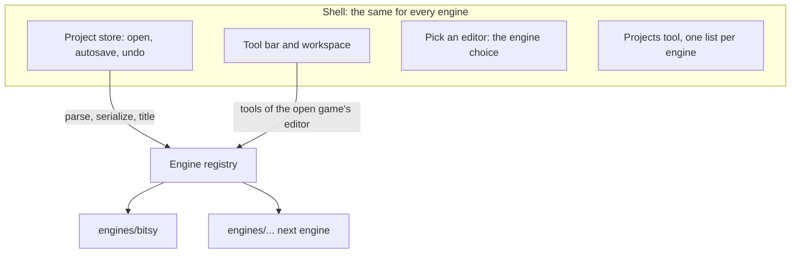
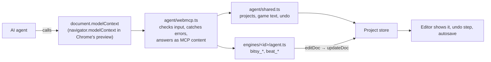

# Engines and editors

The creator can host more than one game engine. Bitsy is the first one. Chili
Beat ([chili-beat](https://github.com/chili-chip/chili-beat)) is the next.

| Word | Means | Example |
|------|-------|---------|
| Engine | One kind of game: its file format, checks and editors. | Bitsy |
| Editor | The tools for making games of one engine. | "Bitsy creator": Room, Paint, Dialog… |
| Document | The open game, in the engine's own type. | Bitsy `World` |
| Shell | What every engine shares: projects, saving, undo, layout, Help, the platform bridge. | `app/src/shell/` |



## Rules

- One project, one engine. A game's engine is the one saved with it, else the
  one whose `detect()` knows its text, else Bitsy.
- Opening a game shows the tools of its engine's first editor, next to the
  shell's tools (Projects). Each editor keeps its own workspace layout.
- The creator starts on **Pick an editor** (`shell/EngineChoice.tsx`), one card
  per turned-on engine. The chosen engine is `state.engine` in the project
  store; `?engine=<id>` opens an editor at once, and opening a game sets it.
  **Change editor** sets it back to null.
- Projects lists the games of the chosen engine (`projectsOf`). Games with no
  `engine` belong to the default engine. **New game** makes a game of the
  chosen engine.
- The shell imports only `engines/types.ts` and `engines/registry.ts`.
  Engines never import each other.

## The engine module

```ts
export interface EngineModule<Doc> {
  id: string;            // saved with projects, never changes
  title: string;         // "Bitsy"
  description: string;   // one line for the engine choice
  icon: LucideIcon;
  format: {
    extension: string;
    detect(text: string): boolean;
    parse(text: string): { doc: Doc; issues: { message: string }[] };
    serialize(doc: Doc): string;
  };
  newGame(title: string): string;
  gameTitle(doc: Doc): string;
  setTitle(doc: Doc, title: string): void;
  check(doc: Doc): EngineProblem[];   // the footer's problem count
  editors: EditorDefinition[];        // the first one is the default
  agentTools?: AgentTool[];           // what AI agents can do, over WebMCP
}
```

Tools read the open document from the store and change it with
`projects.updateDoc<Doc>(recipe)`. The store copies the document, runs the
recipe on the copy, keeps the old one for undo and autosaves the text from
`format.serialize`.

## Adding an engine

1. Make `app/src/engines/<id>/index.ts` that exports an `EngineModule`.
2. Add it to the `engines` list in `app/src/creator.ts`.
3. While it is in progress, leave it out of `enabledEngines`. Testers turn it
   on with `?engines=<id>` in the creator's address.

Shell features are tested with a tiny fake engine (`app/src/engines/fake.ts`),
so they don't depend on any real engine.

## Agent tools

AI agents work on games through tools the creator offers over
[WebMCP](https://webmachinelearning.github.io/webmcp/). People see them in
[Make games with AI](../get-started/ai.md).



| File | Holds |
|---|---|
| `app/src/agent/types.ts` | `AgentTool`: name, title, description, JSON Schema input, `readOnly`, `asksFirst`, `run` |
| `app/src/agent/schema.ts` | `checkInput`: the small part of JSON Schema the tools use. Unknown fields are refused, so typos show. |
| `app/src/agent/webmcp.ts` | `connectAgentTools`: registers each tool; answers `{ content: [...] }`, with `isError` for errors. Browsers hide a rejected promise's reason, so errors are answers too. |
| `app/src/agent/game.ts` | `openGame`, `docOf`, `editDoc`: the open game, and one undo step per change |
| `app/src/agent/shared.ts` | Tools for every engine |
| `app/src/engines/<id>/agent.ts` | The engine's tools |

Rules for tools:

- Name tools `snake_case`. Engine tools start with the engine id: `bitsy_`, `beat_`.
- A tool calls the same edit functions as the editor's tools. Never a second
  way to change a game.
- Change the game with `editDoc(creator, engineId, recipe)`. It is one undo step,
  and when the recipe throws nothing changes.
- Throw an `Error` with a short, plain message the agent can act on, like
  `No room has id "7".`
- Return JSON-able data, or `picture(png, data)` to send an image.
- Set `readOnly` on tools that only read. Set `asksFirst` on tools that cannot be
  undone, and call `confirm()` before acting.
- The creator registers the shared tools and every offered engine's tools at
  start, so an agent sees one list whichever game is open. Engine tools say so
  when the open game is of another engine.
- Add each tool to the tables in `docs/get-started/ai.md`. A test fails when one is
  missing.

Tests: unit tests per engine in `engines/<id>/agent.test.ts`, through a fake
model context (`app/src/test/agent.ts`). End to end, `e2e/agent.spec.ts` gives
the page a stand-in `document.modelContext` and makes a game in each editor
only through tools.

## Platform

The platform does not store the engine yet
([chili-platform#170](https://github.com/chili-chip/chili-platform/issues/170)).
Until it does, the creator finds the engine from the game's text, and the
engine badge in Projects shows only when the platform sends `engine`.
