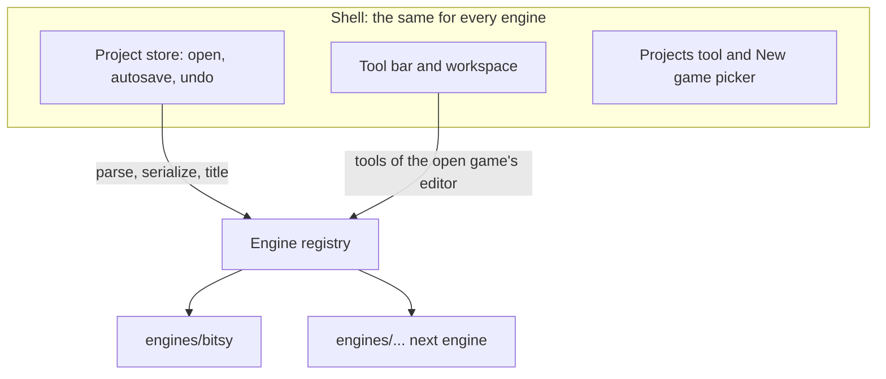

# Engines and editors

The creator can host more than one game engine. Bitsy is the first one. Chili
Beat ([chili-beat](https://github.com/chili-chip/chili-beat)) is the next.

| Word | Means | Example |
|------|-------|---------|
| Engine | One kind of game: its file format, checks and editors. | Bitsy |
| Editor | The tools for making games of one engine. | "Bitsy creator": Room, Paint, Dialog… |
| Document | The open game, in the engine's own type. | Bitsy `World` |
| Shell | What every engine shares: projects, saving, undo, layout, Help, the platform bridge. | `app/src/shell/` |



## Rules

- One project, one engine. A game's engine is the one saved with it, else the
  one whose `detect()` knows its text, else Bitsy.
- Opening a game shows the tools of its engine's first editor, next to the
  shell's tools (Projects). Each editor keeps its own workspace layout.
- **New game** asks which engine to use when more than one is turned on.
  With only Bitsy on, it makes a Bitsy game at once.
- The shell imports only `engines/types.ts` and `engines/registry.ts`.
  Engines never import each other.

## The engine module

```ts
export interface EngineModule<Doc> {
  id: string;            // saved with projects, never changes
  title: string;         // "Bitsy"
  description: string;   // one line for the New game picker
  icon: LucideIcon;
  format: {
    extension: string;
    detect(text: string): boolean;
    parse(text: string): { doc: Doc; issues: { message: string }[] };
    serialize(doc: Doc): string;
  };
  newGame(title: string): string;
  gameTitle(doc: Doc): string;
  setTitle(doc: Doc, title: string): void;
  check(doc: Doc): EngineProblem[];   // the footer's problem count
  editors: EditorDefinition[];        // the first one is the default
}
```

Tools read the open document from the store and change it with
`projects.updateDoc<Doc>(recipe)`. The store copies the document, runs the
recipe on the copy, keeps the old one for undo and autosaves the text from
`format.serialize`.

## Adding an engine

1. Make `app/src/engines/<id>/index.ts` that exports an `EngineModule`.
2. Add it to the `engines` list in `app/src/creator.ts`.
3. While it is in progress, leave it out of `enabledEngines`. Testers turn it
   on with `?engines=<id>` in the creator's address.

Shell features are tested with a tiny fake engine (`app/src/engines/fake.ts`),
so they don't depend on any real engine.

## Platform

The platform does not store the engine yet
([chili-platform#170](https://github.com/chili-chip/chili-platform/issues/170)).
Until it does, the creator finds the engine from the game's text, and the
engine badge in Projects shows only when the platform sends `engine`.
