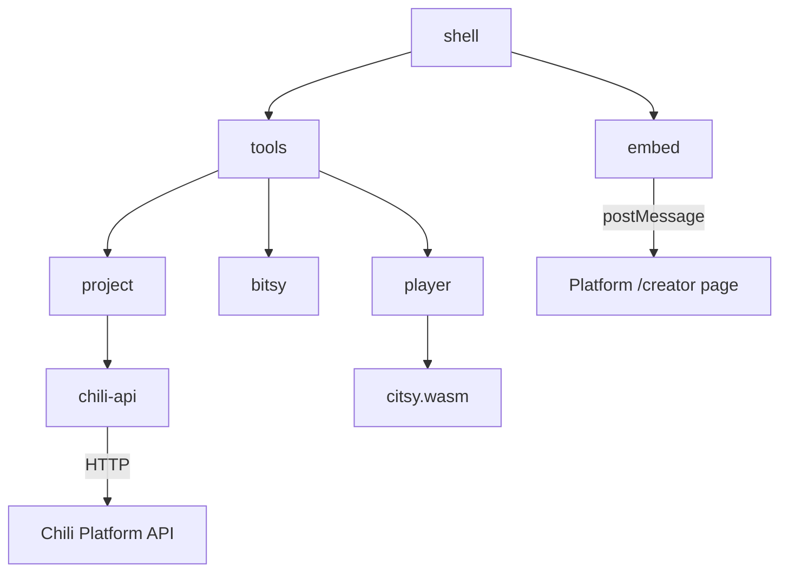

# Develop

This part is for people who work on the creator's code. To make games, start at [Get started](../get-started/index.md).

The creator is React, TypeScript, Vite, [Dockview](https://dockview.dev) and Tailwind. The source is [chili-chip/chili-creator](https://github.com/chili-chip/chili-creator).

## Set up

You need Node 22.

```bash
npm ci
npm run dev           # creator at http://localhost:4301/
```

| Command | Does |
|---|---|
| `npm run dev` | Runs the creator at <http://localhost:4301/>, saving games in the browser |
| `npm test` | Unit and component tests (Vitest) |
| `npm run test:coverage` | The same, with line coverage in `coverage/` |
| `npm run test:e2e` | Playwright against the production build, on desktop and phone sizes |
| `npm run typecheck` | TypeScript, no output |
| `npm run build` | The creator into `dist/` |
| `npm run docs:screenshots` | The screenshots on these docs, see [Writing these docs](docs.md) |

CI runs typecheck, the unit tests, the build and the end-to-end tests on every pull request. Write the tests first: the rules are in [AGENTS.md](https://github.com/chili-chip/chili-creator/blob/main/AGENTS.md).

## Repository layout

| Path | What |
|---|---|
| `app/` | The creator. Builds to `dist/`. |
| `citsy/` | The citsy runtime (`citsy.js`, `citsy.wasm`) and web player (`citsy-player.js`), also used by the platform's `/play` page |
| `e2e/` | Playwright tests. `e2e/fake-platform.ts` stands in for the platform's `/creator` page. |
| `docs/` | These docs (MkDocs) |
| `scripts/` | `prepare.mjs` (builds `dist/` on install) and the docs screenshot script |

## Code in `app/src`

New code goes in `app/src`, one folder per module.

| Folder | What |
|---|---|
| `plugin-api/` | Registries for tools and commands |
| `embed/` | The [platform page contract](platform-contract.md) |
| `bitsy/` | The typed `.bitsy` world model: `parse` and `serialize` (byte for byte on unchanged parts), `edit` and `story` for tool edits, `render` for the editor's pixels, `script` for reading dialog scripts, `references` for who uses what, `sound` for typed tunes and blips, `validate` for [Problems](../tools/problems.md) |
| `player/` | citsy in a Web Worker |
| `sound/` | Previews of tunes, blips and notes in the tools, through the player's synth |
| `export/` | Import from a `.bitsy` or web page file. Export as `.bitsy`, a one-page web player with citsy inline, or a GIF recorded in Play. |
| `chili-api/` | Platform API client, project repositories for the platform and the browser, autosave |
| `project/` | The open project, project lists and the undo history every tool shares, plus what the editing tools have picked |
| `shell/` | Frame, workspace with layout presets, one-tool phone view, first-run tour, command palette |
| `ui/` | Design system, including `PixelCanvas` |
| `tools/` | One folder per tool, registered in `tools/index.ts` |



## Update citsy

The player bundles `citsy/citsy.js` and `citsy/citsy.wasm` into `dist/assets/`. To update them, take both files from the `citsy-web` artifact of chili-chip/citsy's Tests workflow on the commit you want, or run citsy's `scripts/build-web.sh`, which copies them here.

`app/src/player/citsy.test.ts` and `app/src/bitsy/tutorial.test.ts` run the real `citsy.wasm` in Node.

## Try a change inside the platform

Point the platform frontend's dependency at your branch:

```json
"@chili-chip/creator": "github:chili-chip/chili-creator#my-branch"
```

Or run `npm link` here and `npm link @chili-chip/creator` in chili-platform-frontend.

## More

- [Platform contract](platform-contract.md): how the platform page and the creator talk
- [Releasing](releasing.md)
- [Writing these docs](docs.md)
- [Overhaul plan](overhaul-plan.md): the plan behind the current creator
