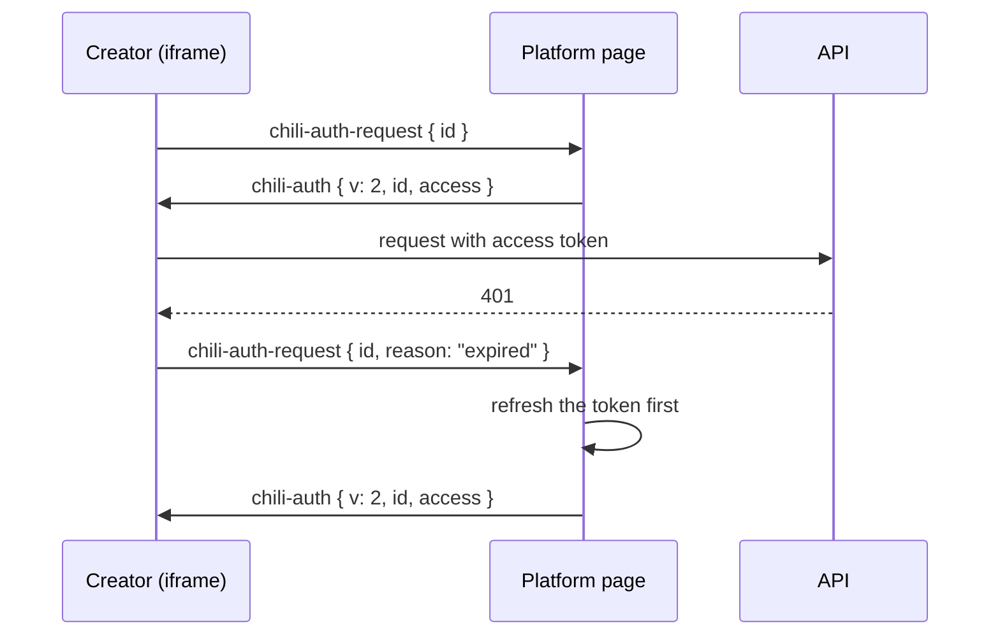

# Platform contract

Chili Platform runs the creator in an iframe on its `/creator` page. This page is the contract between the two. The code is `app/src/embed/bridge.ts`. `app/src/embed/bridge.test.ts` and `e2e/platform-contract.spec.ts` test it.

## How the platform ships the creator

The platform frontend depends on a tagged release of this repository:

```json
"@chili-chip/creator": "github:chili-chip/chili-creator#v0.1.0"
```

Installing the package runs `prepare`, which builds `dist/`. The platform's build copies `citsy/` and `dist/` to `/creator/citsy` and `/creator/app`, so the creator runs on the platform's own origin.

The `/creator` page loads:

```text
/creator/app/index.html?api=<API URL>&project=<id>
```

| Parameter | Meaning |
|---|---|
| `api` | The Chili Platform API the creator calls |
| `project` | The project to open, optional |

## Messages

Every message has `v: 2`.

### Creator to page

| `type` | Data | When |
|---|---|---|
| `chili-toast` | A message | Show a toast on the page |
| `chili-project` | The open project | A project opens |
| `chili-project-new` | The new project | A project is made |
| `chili-project-removed` | The project | A project is deleted |
| `chili-save-state` | `{ state, unsaved }` | The save state changes. The page warns before leaving with unsaved work. |
| `chili-released` | `{ id, slug }` | A game was released from [Projects](../tools/projects.md) |
| `chili-navigate` | `{ to }` | Open a platform page, such as `/games/12` |
| `chili-auth-request` | `{ id, reason? }` | The creator needs an access token |

### Page to creator

| `type` | Data | Meaning |
|---|---|---|
| `chili-auth` | `{ id, access }` | An access token for request `id` |
| `chili-auth` | `{ id, signedOut: true }` | Nobody is signed in |

## Access tokens

The creator never reads or uses the refresh token. It asks the page for an access token:



`reason: "expired"` means the API turned the last token down, so the page refreshes before it answers. Until the page answers, the creator falls back to reading `chili.accessToken` after 1.5 s.

## Changing the contract

Change `bridge.ts`, its tests and `e2e/fake-platform.ts` together, and the platform's `/creator` page in chili-platform-frontend in a matching pull request. Keep `v: 2` unless the change breaks older pages.
