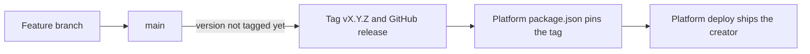

# Releasing

## The creator



1. Bump the version in a pull request: `npm version patch --no-git-tag-version`.
2. Merge it into `main`. CI sees a version with no tag yet, tags it (`v0.2.1`) and publishes a GitHub release.
3. In chili-platform-frontend, bump the tag in `package.json`:

    ```json
    "@chili-chip/creator": "github:chili-chip/chili-creator#v0.2.1"
    ```

4. The platform's own deploys ship the new creator.

A tag pushed by hand publishes a release too. CI checks that the tag matches `package.json`.

## The licences

The platform serves `dist/` as it is, so the licences ship inside it:

| File in `dist/` | What it is |
|---|---|
| `LICENSE.txt` | This repository's licence, with the Bitsy notice |
| `CREDITS.md` | The Bitsy credits |
| `citsy-LICENSE.txt` | citsy's licence (also `citsy/LICENSE`), with the notice for the Bitsy fonts in it |
| `THIRD-PARTY-LICENSES.md` | The licences of the npm packages in the bundle, written by Vite (`build.license`) |

`e2e/licenses.spec.ts` checks they are there.

## These docs

The docs deploy on their own, from `.github/workflows/docs.yml`. See [Writing these docs](docs.md#deploy).
