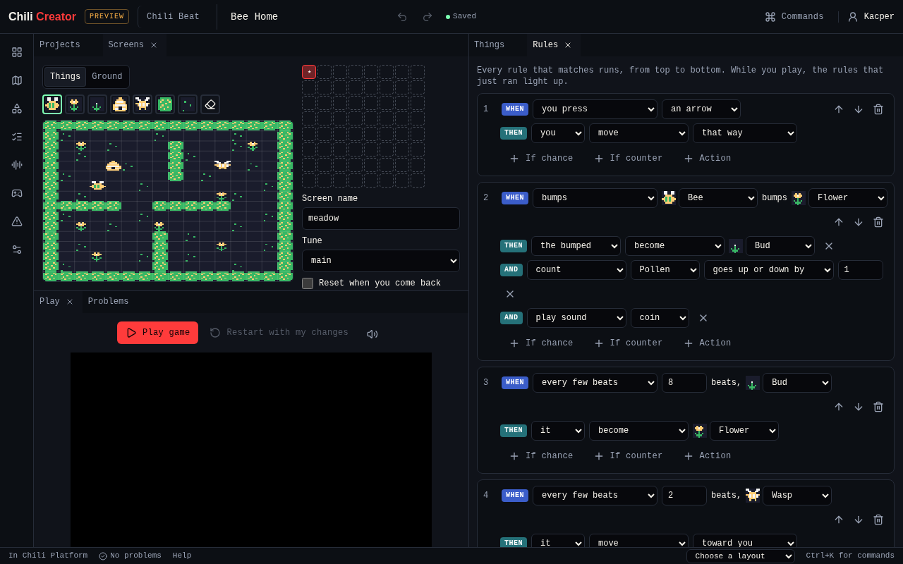

# Chili Beat editor

Chili Beat is the second kind of game you can make in the creator, next to
Bitsy. Everything on the screen is a *thing*. When a thing moves into a cell
that is full, it *bumps* what is there, and your rules decide what happens.
The world moves on a steady beat, and the music plays on the same beat.

{ .shot }

| Idea | In short |
|---|---|
| One screen | A 16 × 16 board of 8 × 8 cells. Walk off an edge to the next screen. |
| Four colours | Each game picks 4 colours from the Sweetie 16 palette. |
| Everything is a thing | Heroes, walls, coins and enemies. One per cell, on top of a ground picture. |
| One verb: bump | Moving into a full cell bumps what is there. With no rule, it acts as a wall. |
| Time is a beat | 2 to 8 beats a second. Or turns: the world moves only when you do. |
| Rules are cards | *When* something happens, *If* something is true, *Then* do something. |

The engine, its file format and every rule are documented in the
[Chili Beat docs](https://github.com/chili-chip/chili-beat/tree/main/docs).

## Start a game

In **Projects**, press **New game**. Pick **Chili Beat** for a blank game, or
start from **Bee Home**, **Crate Puzzle** or **Garden Toy**.

{ .shot }

A blank game has a hero in a walled room and one rule: *When you press an
arrow, you move that way.* The [Bee Home tutorial](tutorial.md) builds a whole
game from there.

## Tools

| Tool | Use it to |
|---|---|
| [Screens](tools/beat-screens.md) | Paint things and ground on each screen, and lay out screens on the world map. |
| [Things](tools/beat-things.md) | Draw the things in a Chili Beat game, name them and choose which ones are you. |
| [Rules](tools/beat-rules.md) | Build the rule cards that decide everything in a Chili Beat game, and add recipes. |
| [Sounds](tools/beat-sounds.md) | Make sound effects and 16-step tunes for a Chili Beat game. |
| [Play](tools/beat-play.md) | Play a Chili Beat game and watch its rule cards light up. |
| [Problems](tools/beat-problems.md) | Find what would stop a Chili Beat game from playing. |
| [Game](tools/beat-game.md) | Set a Chili Beat game's colours, tempo, time, start screen and counters. |

See [Chili Beat tools](tools/index.md) for every control.

## Related

- [Bee Home tutorial](tutorial.md)
- [Projects](../../get-started/projects.md)
- [Credits and licences](../../reference/credits.md)
