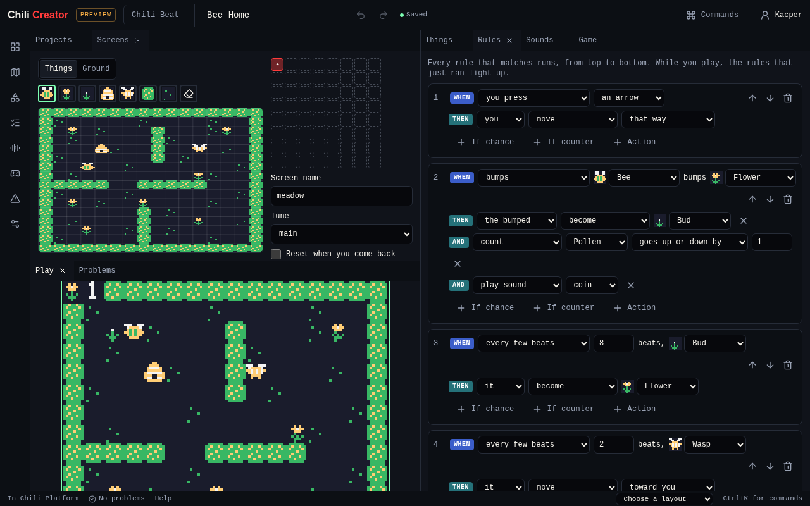

# Play

{ .shot }

Press **Play game**. Arrows or WASD move, ++z++ or ++space++ is A, ++x++ is B,
and the buttons under the screen work on touch screens. While it runs, the
cards that just ran light up in **Rules**. **Restart with my changes** plays
your latest edits. If the game has a mistake, Play says where, for example
`rules[1].do[0].become: no thing has key "z"`.

Play uses the same engine as the platform and the console, so the game plays
the same everywhere.

## Related

- [Chili Beat editor](../index.md)
- [All Chili Beat tools](index.md)
- [Bee Home tutorial](../tutorial.md)
