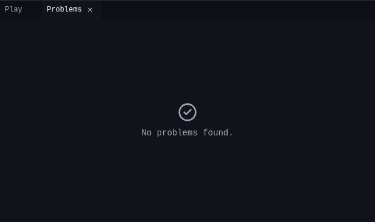

# Problems

{ .shot }

| Level | Checks |
|---|---|
| Error | Nothing on the start screen is "you". A card uses a thing, counter, sound or screen that was deleted. |
| Warning | A card has no actions. |
| Note | No card wins or loses (fine for a toy). A screen can't be reached. |

The status bar shows the count of errors and warnings.

## Related

- [Chili Beat editor](../index.md)
- [All Chili Beat tools](index.md)
- [Bee Home tutorial](../tutorial.md)
