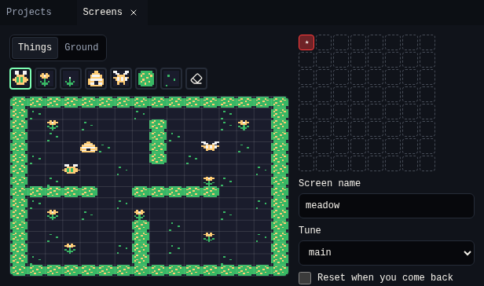

# Screens

{ .shot }

| Part | What it does |
|---|---|
| **Things** / **Ground** | The layer you paint. Things block and bump. Ground is only a picture under them. |
| Brushes | Pick a thing to paint with, or the eraser. |
| Board | Click or drag to paint cells. |
| World map | The 8 × 8 squares on the right. Click a screen to edit it, or an empty square to add one. ★ marks the start screen. |
| **Screen name** | Used by *go to screen* cards. |
| **Tune** | The tune that plays on this screen. |
| **Reset when you come back** | Off: the screen stays as you left it. On: it starts fresh each time. |
| **Start here** | Makes this the screen the game starts on. |

## Related

- [Chili Beat editor](../index.md)
- [All Chili Beat tools](index.md)
- [Bee Home tutorial](../tutorial.md)
