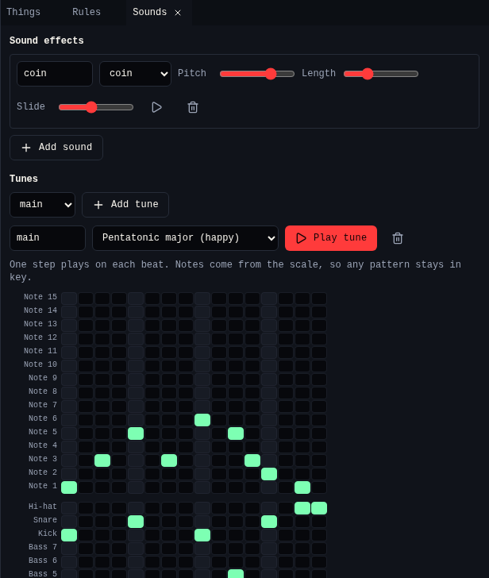

# Sounds

{ .shot }

| Part | What it does |
|---|---|
| Sound effects | A preset (coin, jump, hit, boom, step, power, blip) and **Pitch**, **Length** and **Slide**. ▶ plays it. *Play sound* cards use them. |
| **Tunes** | Pick a tune or **Add tune**. Pick its scale. |
| Melody | 16 steps, one per beat. Click a note to set it, click it again for a rest. |
| Bass and drums | The same, with bass notes, kick, snare and hi-hat. |
| **Play tune** | Plays it at the game's tempo. |

Notes come from the scale, so any pattern stays in key. Give a screen its tune
in **Screens**.

## Related

- [Chili Beat editor](../index.md)
- [All Chili Beat tools](index.md)
- [Bee Home tutorial](../tutorial.md)
