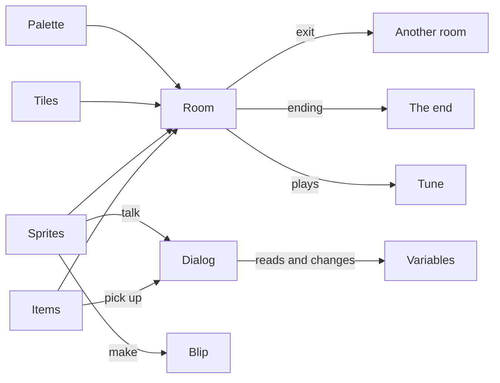

# Bitsy editor

The Bitsy editor makes small story games. You paint rooms out of 8×8 pixel
tiles, put characters and items in them, write what they say, and link rooms
with exits. Games are [Bitsy](https://bitsy.org) games: they play in the
browser, on Chili Platform, as a web page you can put anywhere, and on the
VGC Zero with citsy.

{ .shot }

## Make your first game in five minutes

1. Open the [Creator](https://platform.chilichip.eu/creator) on Chili Platform and sign in.
2. Pick **Bitsy**, then choose **New game** in **Projects**. A new game has one room, an avatar, a cat and two items.
3. In **Library**, pick a tile, then click in the **Room** to draw walls.
4. Pick the cat in **Library** and open **Dialog**. Write what the cat says.
5. Open **Play** and choose **Play game**. Walk with the arrow keys and bump into the cat.

Your game saves itself while you work. When you want more, follow the [tutorial](tutorial/index.md).

## How a game fits together

| Part | What it is | Tool |
|---|---|---|
| Room | 16×16 tiles, the size of one screen | [Room](tools/room.md) |
| Tile | An 8×8 drawing for the floor and walls. Walls stop the avatar. | [Paint](tools/paint.md), [Library](tools/library.md) |
| Sprite | A character. The **avatar** is the sprite the player moves. | [Paint](tools/paint.md), [Library](tools/library.md) |
| Item | Something the avatar picks up and carries | [Paint](tools/paint.md), [Library](tools/library.md) |
| Palette | Three colours: background, tiles, sprites and items | [Colors](tools/colors.md) |
| Dialog | What sprites and items say, with choices and actions | [Dialog](tools/dialog.md) |
| Exit, ending | A cell that takes the avatar to another room, or ends the game | [Exits & endings](tools/exits.md) |
| Variable | A number or word that dialog remembers | [Variables](tools/variables.md) |
| Tune, blip | Music for a room, short sounds for sprites and items | [Tunes](tools/tunes.md), [Blips](tools/blips.md) |

## In this section

| Page | For |
|---|---|
| [Tutorial: Chili Garden](tutorial/index.md) | A two-room game with a quest, a locked gate and an ending, in seven steps |
| [Tools](tools/index.md) | One page for each of the 14 Bitsy editor tools |
| [Dialog scripting](dialog-scripting.md) | Every command the dialog language has, with examples |
| [Differences from Bitsy](differences.md) | What the creator and citsy do differently from the Bitsy editor and engine |
