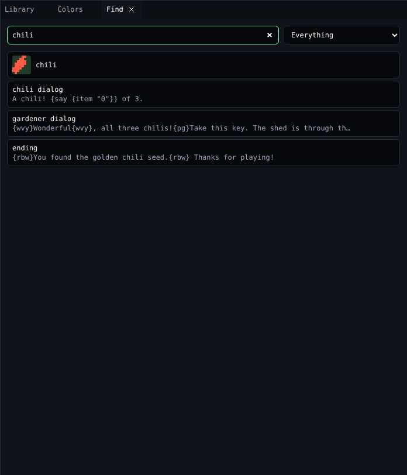

# Find

**Find** searches the whole game. It is the quickest way to answer *where did I put that?*

{ .shot }

## Search

Type a name or a few words of dialog in **Find a name or a line of dialog…**. Narrow it with **Show**:

| Show | Finds |
|---|---|
| Everything | All of the below |
| Drawings | Tiles, sprites and items |
| Rooms | Rooms |
| Dialog and variables | Dialogs, by name or text, and variables |
| Colours | Palettes |
| Tunes and blips | Tunes and blips |

Click a result to open it in its tool.

## Where is it used?

With the search box empty and **Everything** chosen, Find shows **Where … is used** for the drawing you picked: every room it is in and every dialog that mentions it. *Nowhere yet* means you can delete it safely.

## Related

- [Library](library.md)
- [Problems](problems.md)
