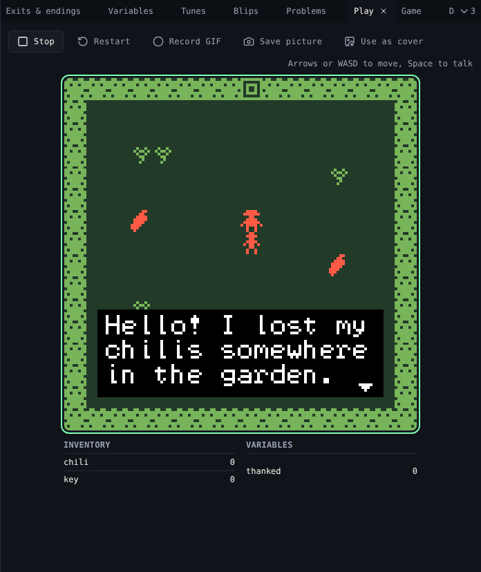

# Play

**Play** runs your game as it is now, with **citsy**, the same engine that plays it on Chili Platform and on VGC Zero.

{ .shot }

## Play

Choose **Play game**. Click the game screen if keys do not reach it.

| Action | Keyboard | Phone |
|---|---|---|
| Walk | Arrow keys or ++w++ ++a++ ++s++ ++d++ | On-screen **Up**, **Down**, **Left**, **Right** |
| Talk, next page, start | ++space++, ++enter++, ++z++ or ++x++ | **Ok**, or tap the screen |

| Button | Does |
|---|---|
| **Stop** | Stops the game |
| **Restart** | Starts again from the title |

The game does not change while it plays. Edit, then **Restart** to see the change.

## Inventory and variables

Under the screen, two tables show the running game:

- **Inventory**: how many of each item the avatar carries.
- **Variables**: every variable's value.

They update as you play, so you can see a dialog change a variable or give an item.

## Pictures and GIFs

| Button | Does |
|---|---|
| **Record GIF** | Records up to 30 seconds of play. **Stop recording** downloads it, at 256×256 pixels. |
| **Save picture** | Downloads the screen as a PNG, 512×512 pixels |
| **Use as cover** | Makes the screen your game's cover on Chili Platform |

## Related

- [Problems](problems.md) before you play
- [7. Test and release](../tutorial/7-test-and-release.md)
- [Differences from Bitsy](../differences.md): how citsy plays games
