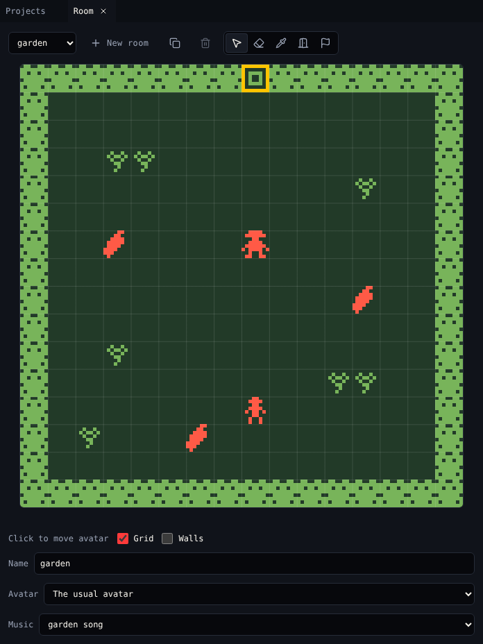
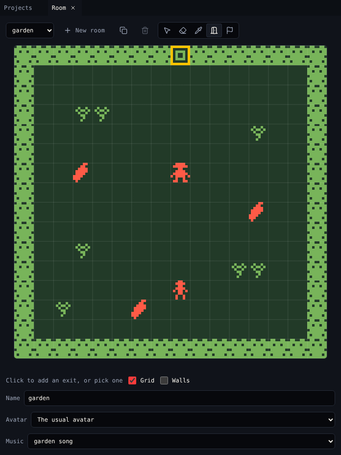

# Room

**Room** shows one room of your game at a time, 16×16 cells. It is where you build the world.

{ .shot }

## The room tools

| Tool | Key | Click a cell to |
|---|---|---|
| **Place** | ++p++ | Paint the tile, move the sprite, or put down the item you picked in [Library](library.md) |
| **Erase** | ++e++ | Remove the top thing on the cell: an exit or ending, then a sprite (not the avatar), then an item, then the tile |
| **Pick** | ++i++ | Pick what is on the cell, then go back to Place |
| **Exit** | ++x++ | Add an exit, or pick one that is there |
| **Ending** | ++n++ | Add an ending, or pick one that is there |

The line under the room says what a click does now, like *Click to paint hedge* or *Click to move gardener*.

### What Place does

| You picked a | Click | Drag |
|---|---|---|
| Tile | Paints it. Clicking a cell that has the same tile clears it. | Paints or clears along the way |
| Sprite | Moves the sprite there. A sprite is in one place at a time. | Moves it |
| Item | Puts one down, or takes it away if it is there | |

## Rooms

| Control | Does |
|---|---|
| Room menu | Switches room |
| **New room** | Adds an empty room and shows it |
| **Copy room** | Copies this room with everything in it |
| **Delete room** | Deletes the room and the exits into it, after asking. Off for the room the avatar is in, and for the last room. |
| **Name** | The room's name, shown in menus |
| **Avatar** | The sprite the player is in this room. *The usual avatar* keeps sprite A. |
| **Music** | The tune that plays while the avatar is in this room. Make tunes in [Tunes](tunes.md). |

The room's colours come from its palette. Change it in [Colors](colors.md).

## Helpers

- **Grid** shows the cell lines.
- **Walls** marks every wall tile, so you can see where the avatar can walk.
- The bottom right shows the cell under the pointer, like `x 8, y 0 · gate`.
- Exits show as amber outlines, endings in red. The one you picked has a thick outline.

## Exits and endings

Room adds them; [Exits & endings](exits.md) sets them up: where an exit leads, which way, the transition, a lock, and the text of an ending.

{ .shot }

## Related

- [1. Rooms](../tutorial/1-rooms.md) in the tutorial
- [Library](library.md) to pick what you place
- [Keyboard shortcuts](../../../reference/keyboard-shortcuts.md)
