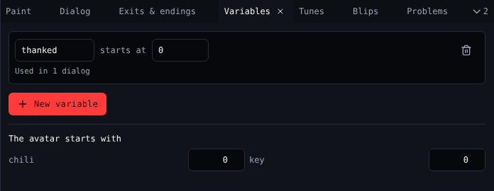

# Variables

A **variable** is a number or a word that dialog can read and change while the game runs. Use one to remember anything that is not an item: whether you met someone, a score, a choice.

{ .shot }

## Variables

| Control | Does |
|---|---|
| Name | The variable's name. Dialog uses it, like `{say thanked}`. |
| **starts at** | The value when the game starts: a number like `0`, or a word |
| *Used in …* | How many dialogs use it, or *Not used yet* |
| **Delete** | Deletes the variable |
| **New variable** | Adds one |

## The avatar starts with

One number per item: how many of it the avatar carries at the start. Most games start with 0 of everything.

## Use them in dialog

| Block | Script |
|---|---|
| Set a variable | `{thanked = 1}` |
| Change a variable | `{score = score + 10}` |
| Show a variable | `{say score}` |
| If a variable is… | `{ - thanked == 1 ? … - else ? … }` |

See [Dialog scripting](../dialog-scripting.md) for every operator.

## Watch them

While the game plays, [Play](play.md) shows every variable and item count live under the game screen.

## Related

- [6. Variables](../tutorial/6-variables.md) in the tutorial
