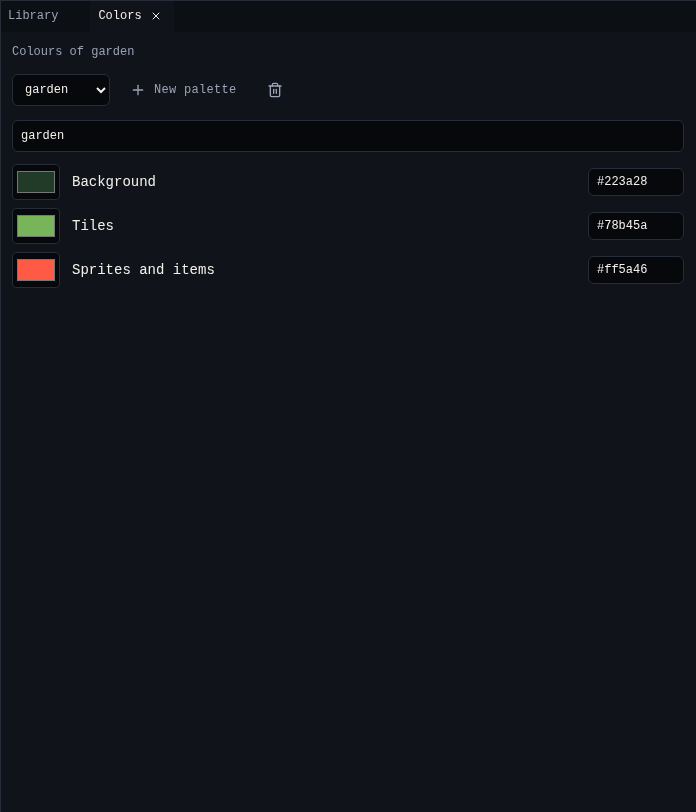

# 1. Rooms

A room is one screen of your game: 16×16 cells, each 8×8 pixels. That is 128×128 pixels, the size of the VGC Zero screen. In this step you make the garden.

{ .shot }

## Start a new game

1. Open the creator, pick **Bitsy**, and choose **New game** in [Projects](../../../get-started/projects.md).
2. Click the title **Untitled game** in the top bar and type `Chili Garden`.

A new game already has a room with a wall around it, the avatar, a cat, a cup of tea and a key. You change all of them in the next steps.

## Choose the colours

Every room uses a **palette** of three colours.

1. Open [Colors](../tools/colors.md). It shows the colours of the room in front in Room.
2. Rename the palette to `garden`.
3. Set the three colours. Click a swatch to pick, or type a hex code:

    | Colour | Used for | Chili Garden |
    |---|---|---|
    | Background | Empty cells, the inside of drawings | `#223a28`, dark green |
    | Tiles | Every tile | `#78b45a`, leaf green |
    | Sprites and items | The avatar, characters and items | `#ff5a46`, chili red |

{ .shot }

## Draw the hedge

The new game has one tile, **block**. Turn it into a hedge.

1. Open [Library](../tools/library.md) and choose **Tiles**. Pick **block**.
2. [Paint](../tools/paint.md) shows it large. Rename it `hedge`.
3. Draw with the **Pencil** (++b++): click a pixel to turn it on, click it again to turn it off. Drag to draw a line. **Fill** (++f++) fills an area.
4. Tick **Wall** so the avatar cannot walk through it.

!!! tip
    A tile looks best when its edges match, so it repeats without seams. Try leaving the same pixels on at the left and right edge.

## Draw a flower

1. In Library, choose **New tile**. Name it `flower` and draw it. Leave **Wall** off, so the avatar walks over it.
2. Make one more tile called `gate` for the opening at the top of the room. Leave it off **Wall** too.

## Paint the room

1. Open [Room](../tools/room.md). Rename the room `garden` in **Name**.
2. Pick **hedge** in Library and choose the **Place** tool (++p++) in Room.
3. Click or drag in the room to paint. The new game's walls are already there; fill any gaps you want.
4. Pick **gate** and click the middle of the top edge, cell 8,0. The cell under the pointer shows at the bottom right of Room.
5. Pick **flower** and dot a few around.

| To | Do |
|---|---|
| Remove a tile | Click it again with the same tile, or use **Erase** (++e++) |
| Find out what is on a cell | **Pick** (++i++), then click the cell |
| See which tiles are walls | Tick **Walls** under the room |
| Hide the grid | Untick **Grid** |
| Undo a stroke | ++ctrl+z++ |

## Check it

Open [Play](../tools/play.md) and choose **Play game**. Walk around with the arrow keys: the hedge stops you, the flowers do not.

## Next

[2. Avatar and sprites](2-avatar-and-sprites.md): draw the player and the gardener.
