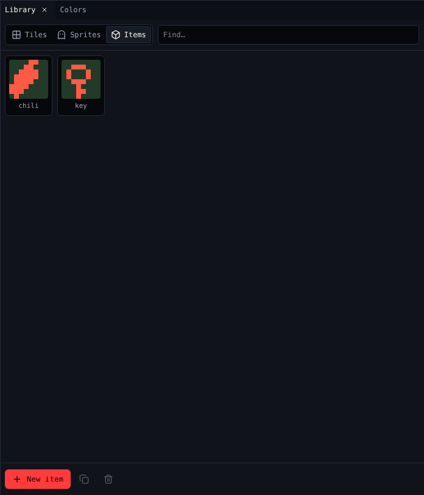

# 3. Items

**Items** are things the avatar picks up by walking onto them. The game counts how many of each the avatar carries. In this step you hide three chilis in the garden.

{ .shot }

## Draw the chili

1. Open [Library](../tools/library.md) and choose **Items**.
2. Pick **tea**, rename it `chili` in [Paint](../tools/paint.md), and draw a chili.
3. In **Sound**, pick **pick up key**, or make your own `pick up` blip.

Leave the **key** as it is. The gardener gives it away in step 4.

## Scatter the chilis

1. With the chili picked, Room says *Click to put down chili*.
2. Click three cells in the garden, away from the gardener. Chili Garden uses 3,6, 12,8 and 6,13.

Clicking a cell that already has the chili takes it away again.

## What a chili says

When the avatar picks an item up, its dialog shows. Open [Dialog](../tools/dialog.md) with the chili picked and write:

```text
A chili! {say {item "0"}} of 3.
```

`{say {item "0"}}` shows how many chilis the avatar has, so the player reads *A chili! 2 of 3.* The `"0"` is the chili's id; Dialog's **Insert…** menu writes it for you with **Show how many of an item**. See [Dialog scripting](../dialog-scripting.md).

## Starting items

To start the avatar with some items, open [Variables](../tools/variables.md) and set a number under **The avatar starts with**. Chili Garden starts with none.

## Check it

Play the game, pick up the chilis, and watch the count in the **Inventory** table under the game screen.

## Next

[4. Dialog](4-dialog.md): the gardener asks for the chilis.
