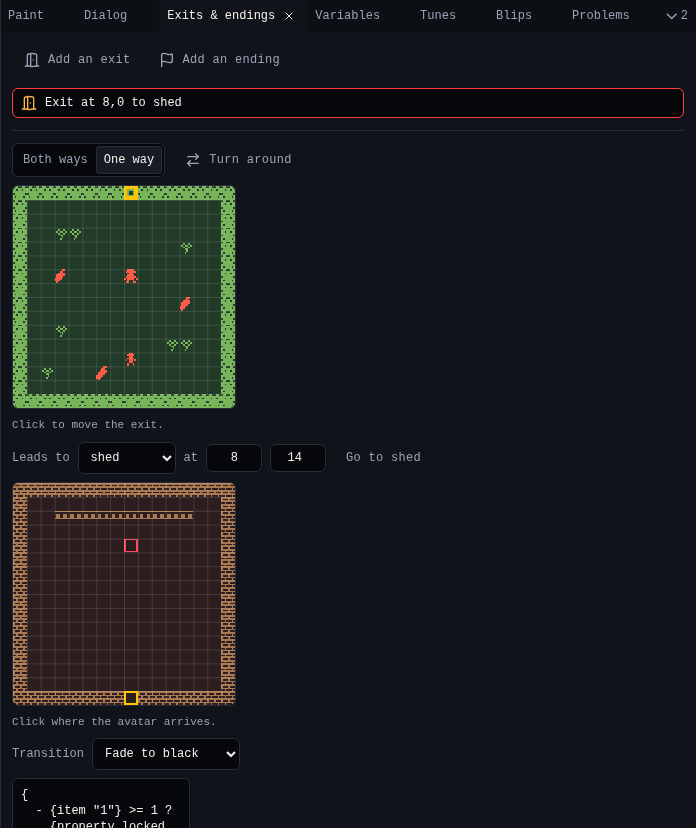

# 5. Exits and endings

An **exit** is a cell that takes the avatar to another room. An **ending** is a cell that shows some text and ends the game. In this step you build the shed, lock the gate, and put the ending inside.

## Add the shed

1. In [Room](../tools/room.md), choose **New room**. Name it `shed`.
2. Open [Colors](../tools/colors.md) and choose **New palette**. It starts as a copy of the garden colours and the shed uses it. Name it `shed` and pick warm browns:

    | Colour | Shed |
    |---|---|
    | Background | `#2c1e1e` |
    | Tiles | `#aa7850` |
    | Sprites and items | `#ffd26e` |

3. Draw a `brick wall` tile (with **Wall** on) and a `shelf`, and paint the shed: walls around the edge, a shelf near the top, and a gap in the middle of the bottom wall at 8,15.

## Connect the rooms

1. Go back to the garden in Room's room menu.
2. Choose the **Exit** tool (++x++) and click the gate at 8,0. An exit appears, and [Exits & endings](../tools/exits.md) shows it.

    { .shot }

3. In Exits & endings, set **Leads to** to **shed**. Click the small map of the shed where the avatar arrives: 8,14, just inside the gap.
4. Choose **Both ways**. The creator adds the exit back from the shed to the garden for you.
5. Set **Transition** to **Fade to black**.

{ .shot }

## Lock the gate

Choose **Add a lock**. The creator writes a script for the exit that checks for an item called *key*:

```text
{
  - {item "1"} >= 1 ?
    {property locked false}
    The key opens the gate!
  - else ?
    {property locked true}
    The gate is locked...
}
```

`{property locked true}` keeps the avatar out. Change the two lines of text to fit your game. **Add narration** instead writes plain text that shows as the avatar goes through.

## End the game

1. Go to the shed. Choose the **Ending** tool (++n++) in Room and click 8,4, under the shelf.
2. In Exits & endings, write the ending text:

    ```text
    {rbw}You found the golden chili seed.{rbw} Thanks for playing!
    ```

The game ends after this text. On the next button press it starts again from the title, like in Bitsy.

## Check it

Play the game. Without the key the gate says *The gate is locked...*; with it, the screen fades to the shed. Walk to the ending.

| Want | Use |
|---|---|
| An exit only one way | **One way**, then **Turn around** to swap its ends |
| Send the avatar somewhere from dialog | **Go to a room** in Dialog (`{exit "1" 8 8}`) |
| End the game from dialog | **End the game** in Dialog (`{end}`) |
| A door that opens after a quest, not a key | Edit the exit script to check a [variable](6-variables.md) |

## Next

[6. Variables](6-variables.md): remember what happened.
