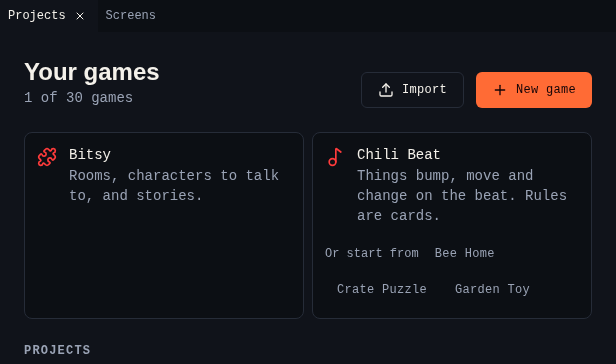

# Editors

Each editor in the creator makes one kind of game. They share the workspace,
[Projects](../get-started/projects.md), autosave, undo and Help, and each one
brings its own tools.

| | [Bitsy editor](bitsy/index.md) | [Chili Beat editor](beat/index.md) |
|---|---|---|
| Good for | Stories, exploring, talking to characters | Puzzles, chases, toys, rhythm games |
| Screen | Rooms of 16×16 tiles | Screens of 16×16 cells |
| Colours | 3 per palette, any colours | 4 from the Sweetie 16 palette |
| What happens | Dialog with choices and variables | Rule cards: When, If, Then |
| Time | Moves when you move | On the beat, 2 to 8 times a second, or in turns |
| Sound | Tunes per room, blips per sprite | Tunes per screen, sound effects from rules |
| File | `.bitsy` | `.beat` |
| Tutorial | [Chili Garden](bitsy/tutorial/index.md) | [Bee Home](beat/tutorial.md) |

## Which editor a game uses

- **New game** in Projects asks which editor to use. Each editor also offers
  example games to start from.
- A game always opens in the editor that made it. The tool bar shows that
  editor's tools next to **Projects**.
- **Import** reads Bitsy files and pages. A `.beat` file opens in the Chili
  Beat editor.

{ .shot }
