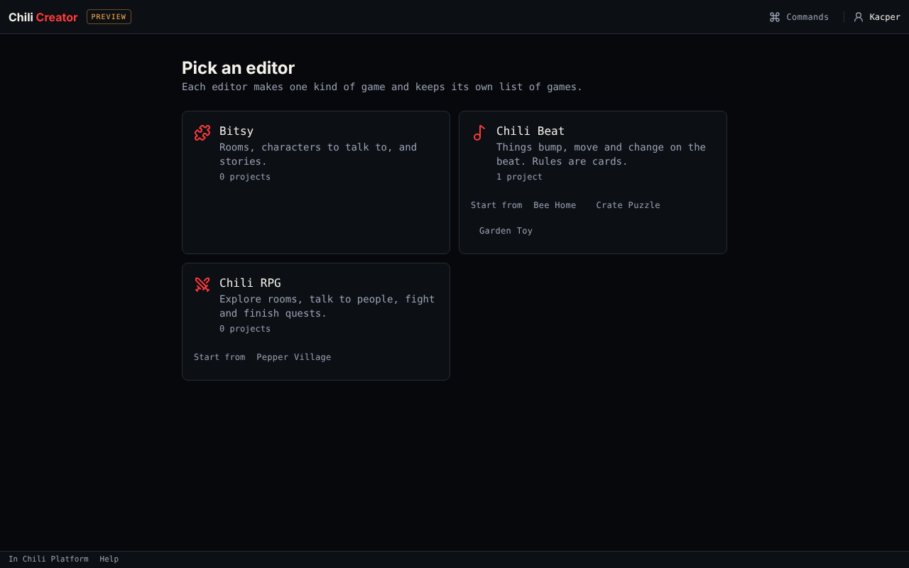

# Editors

Each editor in the creator makes one kind of game. They share the workspace,
[Projects](../get-started/projects.md), autosave, undo and Help, and each one
brings its own tools.

| | [Bitsy editor](bitsy/index.md) | [Chili Beat editor](beat/index.md) | [Chili RPG editor](rpg/index.md) |
|---|---|---|---|
| Good for | Stories, exploring, talking to characters | Puzzles, chases, toys, rhythm games | Adventures: explore, talk, fight, quests |
| Screen | Rooms of 16×16 tiles | Screens of 16×16 cells | Rooms of 16×16 to 64×64 tiles, which scroll |
| Colours | 3 per palette, any colours | 4 from the Sweetie 16 palette | All 16 of Sweetie 16 |
| What happens | Dialog with choices and variables | Rule cards: When, If, Then | Events: If, Do, Else, in dialogue, items, characters, triggers and quests |
| Time | Moves when you move | On the beat, 2 to 8 times a second, or in turns | In turns: the world moves when the hero moves |
| Sound | Tunes per room, blips per sprite | Tunes per screen, sound effects from rules | Built-in sound effects from events |
| File | `.bitsy` | `.beat` | `.rpg` |
| Tutorial | [Chili Garden](bitsy/tutorial/index.md) | [Bee Home](beat/tutorial.md) | [Lost Ring](rpg/tutorial.md) |

## Which editor a game uses

- The creator starts on **Pick an editor**. Picking one opens that editor,
  with its own list of games in **Projects**. Each card also offers the
  editor's example games.
- **New game** makes a game for the editor you are in.
- A game always opens in the editor that made it. The tool bar shows that
  editor's tools next to **Projects**.
- **Change editor**, the editor's name at the top left, goes back to the
  choice.
- **Import** reads Bitsy files and pages. A `.beat` file opens in the Chili
  Beat editor, and a `.rpg` file in the Chili RPG editor.

{ .shot }
