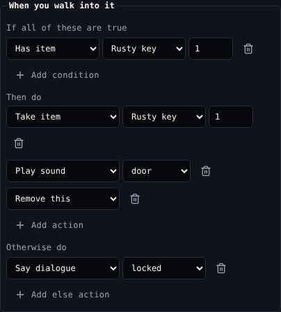

# Events

An event says *when this happens, do that*. It is how a door opens, a potion
heals, a line of dialogue shows only later in the story, and a quest ends the
game. Every Chili RPG tool shows events as the same form.

{ .shot }

| Part | Means |
|---|---|
| **If all of these are true** | Conditions. With none, the event always runs. |
| **Then do** | Actions, run from top to bottom. |
| **Otherwise do** | Actions that run when a condition fails. Shows once there is a condition. |

**Add condition**, **Add action** and **Add else action** add a row. The first
box of a row picks what it is; the rest of the row changes to fit. The bin
removes the row.

## Where events run

| Where | Runs when |
|---|---|
| [Characters](tools/rpg-characters.md): *When you walk into it* | The hero walks into a friendly character, or presses A facing it. |
| [Characters](tools/rpg-characters.md): *When it dies* | An enemy of that kind is beaten. |
| [Items](tools/rpg-items.md): *When it is used* | The hero uses the item from the bag. |
| [Dialogue](tools/rpg-dialogue.md): a line | The line shows only when its conditions pass. Its actions run after it is read. |
| [Dialogue](tools/rpg-dialogue.md): a choice | The hero picks the choice. |
| [Quests](tools/rpg-quests.md): *When stage n is done* | The stage's goal is met. |
| [Rooms](tools/rpg-rooms.md): a trigger | The hero steps on its cell. Once, unless **Only once** is off. |
| [Hero](tools/rpg-hero.md): *When the hero dies* | The hero's HP reaches 0. |

## Conditions

| Condition | True when |
|---|---|
| Flag is on | The flag is on. Naming a flag makes it; flags start off. |
| Flag is off | The flag is off. |
| Has item | The hero has at least that many of the item. |
| Quest | The quest is not started, at a stage, at a stage or later, done, or not done. |
| Variable | A variable compares to a number. Variables start at 0. |
| Stat | One of the hero's stats compares to a number. |

## Actions

| Action | Does |
|---|---|
| Say dialogue | Starts a dialogue. |
| Give item / Take item | Puts items in the bag, or takes them out. |
| Turn flag on / Turn flag off | Sets a flag. |
| Add to variable | Adds a number, which can be negative. |
| Set quest | Starts a quest (stage 1), jumps to a stage, or finishes it. |
| Heal / Hurt | Changes the hero's HP. |
| Give XP | Gives XP. The hero can level up. |
| Raise stat | Adds to one of the hero's stats for good. |
| Warp | Moves the hero to a room and tile, with a fade. |
| Play sound | One of the built-in sounds: step, bump, hit, hurt, miss, pickup, door, level, save, quest, win, lose. |
| Save the game | Saves, as a save point does. |
| Remove this | Removes the character the event belongs to, for good: a door, a chest. |
| End the game | Ends it, won or lost. |

## Flags and variables

Flags and variables need no list. Type a name into a row, and every other row
offers it. Names are lower case letters, digits, `-` and `_`. Both go into the
save.

## Recipes

| Want | Do |
|---|---|
| A locked door | A friendly character *Door*. When you walk into it: if *Has item Key*, then *Take item Key*, *Play sound door*, *Remove this*; otherwise *Say dialogue locked*. |
| A cut-in when you enter | A trigger by the door: if *Flag is off seen-cave*, then *Turn flag on seen-cave*, *Say dialogue cave*. |
| People say new things | Dialogue lines with a *Quest* or *Flag* condition. |
| An ending | *End the game* in the last quest stage, or in the last line of a dialogue. |
| A coin counter | *Add to variable coins* when you pick one up, and a *Variable* condition where you spend them. |

## Related

- [Chili RPG editor](index.md)
- [Events in the game SDK](https://game-sdk.chilichip.eu/rpg/events/)
