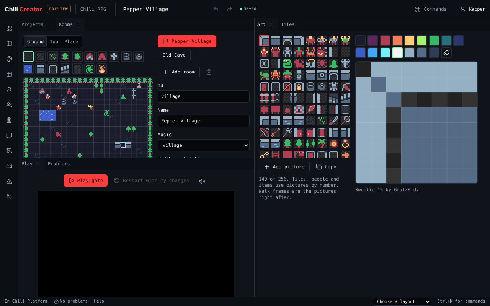

# Chili RPG editor

Chili RPG is the third kind of game you can make in the creator, next to
Bitsy and Chili Beat. You walk a hero through rooms, talk to people, fight
enemies, fill a bag and finish quests. Everything is made with forms and
painting. There is no code to write.

{ .shot }

| Idea | In short |
|---|---|
| Rooms | 16 × 16 to 64 × 64 tiles. Bigger rooms scroll with the hero. Warps lead from room to room. |
| Pictures | 8 × 8 pixels in the 16 colours of Sweetie 16, with clear pixels. Up to 256. |
| Tiles | The ground: a picture, and whether it is solid, water, a save point or hurts. |
| Characters | People to talk to and enemies to fight. Each has a brain that moves it. |
| Turns | The world moves when the hero moves. Bump an enemy to hit it. |
| Events | *If* these are true, *do* these actions, *else* those. Dialogue, items, doors, triggers and quests all use them. |
| Quests | Stages with a goal: talk to someone, have an item, beat enemies, reach a place. |
| Saves | Step on a save point, or save from the pause menu on the console. |

The engine is the RPG engine of the
[chili game SDK](https://game-sdk.chilichip.eu/rpg/). Its docs explain every
field of the `.rpg` file and how each part plays.

## Start a game

Open the creator and pick **Chili RPG**. In **Projects**, press **New game** for
a blank game, or start from **Pepper Village**, the example game.

A blank game has a hero in one walled room, the stats HP, MAX, ATK and DEF, and
three pictures. The [Lost Ring tutorial](tutorial.md) builds a small quest from
there in about 10 minutes.

## Tools

| Tool | Use it to |
|---|---|
| [Rooms](tools/rpg-rooms.md) | Paint the ground and the top layer, place people, items, warps, triggers and the start, and size each room. |
| [Art](tools/rpg-art.md) | Draw the pictures for tiles, people and items. |
| [Tiles](tools/rpg-tiles.md) | Set up the kinds of ground: picture, animation, solid, water, save point, damage. |
| [Hero](tools/rpg-hero.md) | Set the hero's look, stats and levels, and what happens when the hero dies. |
| [Characters](tools/rpg-characters.md) | Make people and enemies: look, brain, stats, drops, dialogue and events. |
| [Items](tools/rpg-items.md) | Make potions, gear, keys and quest items, and the equipment slots. |
| [Dialogue](tools/rpg-dialogue.md) | Write what people say, with lines that depend on the story and choices that jump. |
| [Quests](tools/rpg-quests.md) | Write quests in stages, each with a goal and an event when it is met. |
| [Play](tools/rpg-play.md) | Play the game in the real engine, with the room, HP and quests shown under it. |
| [Problems](tools/rpg-problems.md) | Find what would stop the game from playing. |
| [Game](tools/rpg-game.md) | Set the author, background, start and the rules for steps, the bag and damage. |

See [Chili RPG tools](tools/index.md) for every control, and
[Events](events.md) for the conditions and actions every tool shares.

## Play it on the console

A released Chili RPG game plays on the platform, and on the chilichip console
with the **Chili RPG** app, which opens `.rpg` files from the home screen. Each
game file keeps its own save.

## Related

- [Lost Ring tutorial](tutorial.md)
- [Events](events.md)
- [AI agents](../../get-started/ai.md#chili-rpg-editor)
- [Credits and licences](../../reference/credits.md)
