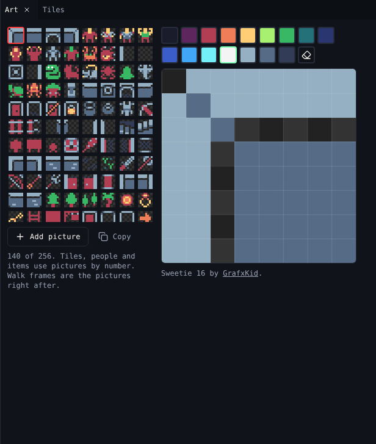

# Art

{ .shot }

A game has up to 256 pictures of 8 × 8 pixels. Tiles, characters, items and the
hero use them by number, shown when you hold the pointer over one.

| Control | Does |
|---|---|
| A picture in the list | Picks it to draw. |
| **Add picture** | Adds a clear picture at the end. |
| **Copy** | Adds a copy of the picked picture, for a walk frame or a new colour. |
| The 16 colours | The [Sweetie 16](https://lospec.com/palette-list/sweetie-16) palette by GrafxKid. |
| Eraser | Clear: the ground or the background shows through. Clear pixels show as a grey check. |

Draw by clicking or dragging. With the keyboard, the arrows move the cursor
and ++space++ paints.

**Walk frames.** A character or the hero with 2 to 4 walk frames uses its
picture and the ones right after it. Draw the frames next to each other, with
**Copy**.

## Related

- [Chili RPG editor](../index.md)
- [All Chili RPG tools](index.md)
- [Lost Ring tutorial](../tutorial.md)
