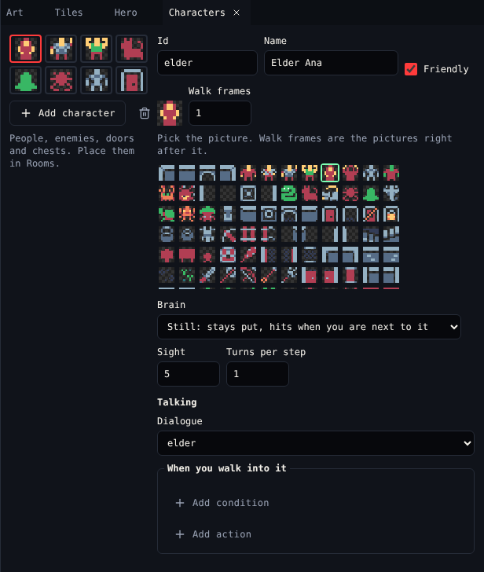
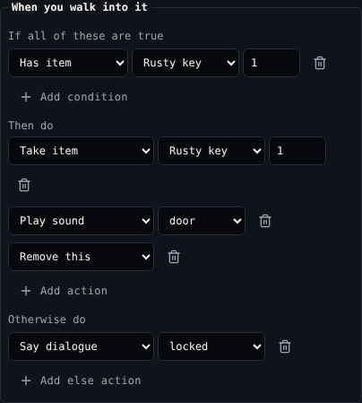

# Characters

{ .shot }

A character is a kind of person, enemy, door or chest. Place as many of each as
you like in [Rooms](rpg-rooms.md). **Add character** makes a friendly one; the
bin deletes the picked one and its people in every room.

| Setting | Means |
|---|---|
| Id, Name | The id names it in the file; the name shows in dialogue and fights. |
| Friendly | Friendly characters are talked to, never fought. Others fight. |
| Picture, Walk frames | As for the [hero](rpg-hero.md). |
| Brain | How it moves, below. |
| Sight | How far it sees, in tiles. |
| Turns per step | 1 acts every turn, 3 every third turn. |
| Home range | For a guard: how far it chases from home. |
| Runs below HP % | For a coward: when it runs away. |

| Brain | Moves |
|---|---|
| Still | Stays put. Hits the hero when next to it. |
| Wander | Takes random steps. |
| Chase | Walks to the hero when it sees the hero. |
| Guard | Chases near its home, then walks back. |
| Patrol | Walks its patrol points in a loop. Set them on the character in [Rooms](rpg-rooms.md). |
| Coward | Chases, and runs away when hurt. |

## Enemies

An enemy shows **Fighting**: its HP, ATK and DEF, the **XP** the hero gets for
beating it, **Drops** (items it leaves, with a chance in percent), and **When
it dies**, an [event](../events.md).

## Friendly characters

A friendly character shows **Talking**: the **Dialogue** it starts, and **When
you walk into it**, an [event](../events.md) that runs after it. A door is a
friendly character with no dialogue, whose event checks for a key and ends with
*Remove this*.

{ .shot }

## Related

- [Chili RPG editor](../index.md)
- [All Chili RPG tools](index.md)
- [Lost Ring tutorial](../tutorial.md)
