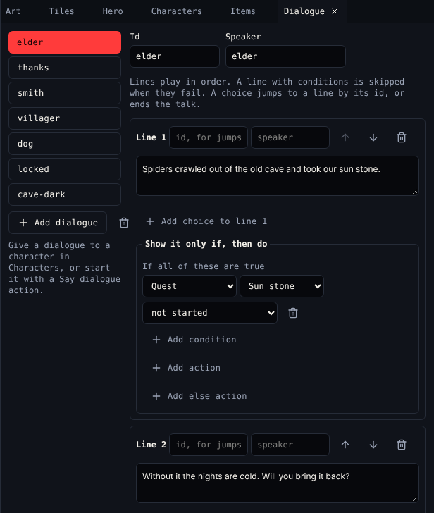

# Dialogue

{ .shot }

A dialogue is a list of lines. Give it to a friendly character in
[Characters](rpg-characters.md), or start it with the *Say dialogue* action.

| Setting | Means |
|---|---|
| Id | Its name in the file. |
| Speaker | A character id shows that character's name and picture. Any other text shows as it is. |
| Line text | Up to 400 characters. Long text goes on more pages by itself. |
| Line id | A name, so a choice can jump to the line. |
| Line speaker | Another speaker for this line only. |
| Arrows, bin | Move or delete the line. |
| **Add choice to line n** | Up to 4 choices of up to 20 characters. |
| Goes to | The line a choice jumps to, or **ends the talk**. |
| What picking it does | The choice's [event](../events.md). |
| Show it only if, then do | The line's [event](../events.md): conditions that skip it, and actions after it is read. |

## How it plays

Lines play from the top. A line whose conditions fail is skipped. After the
hero reads a line, its actions run. A line with choices waits for one; the
choice runs its actions and jumps, or ends the talk. When the last line is
done, so is the talk, and quest goals are checked.

So one dialogue can say different things at each step of a story: give each
line a *Quest* or *Flag* condition, as Elder Ana's lines do.

## Related

- [Chili RPG editor](../index.md)
- [All Chili RPG tools](index.md)
- [Lost Ring tutorial](../tutorial.md)
