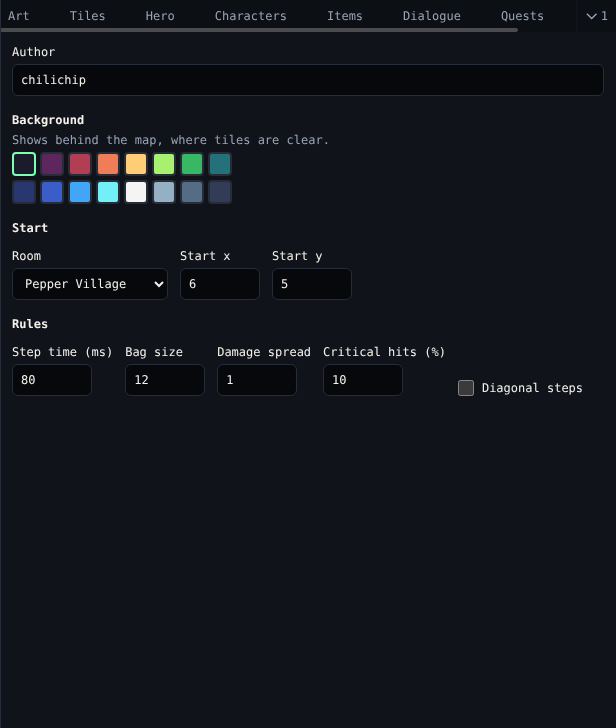

# Game

{ .shot }

| Setting | Means |
|---|---|
| Author | Shown on the title screen on the console. |
| Background | Shown behind the map, where tiles are clear. |
| Start | The room and cell a new game starts on. You can also place the start in [Rooms](rpg-rooms.md). |
| Step time | How long one step slides, in ms. 80 by default. |
| Bag size | Slots in the bag, 1 to 32. 16 by default. |
| Damage spread | Hits vary by up to this much either way. |
| Critical hits | The chance, in percent, of a hit doing double damage. |
| Diagonal steps | The hero and the brains can step diagonally (two D-pad buttons at once). |

The game's title is at the top of the creator, as in every editor.

## Related

- [Chili RPG editor](../index.md)
- [All Chili RPG tools](index.md)
- [Lost Ring tutorial](../tutorial.md)
