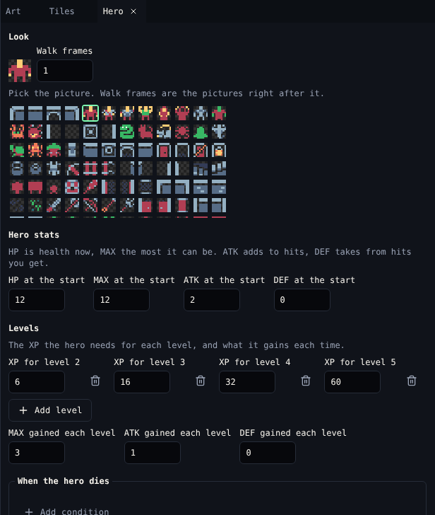

# Hero

{ .shot }

| Setting | Means |
|---|---|
| Look | The hero's picture, and 1 to 4 walk frames (the pictures right after it). |
| Hero stats | Start values. **HP** is health now, **MAX** the most it can be. **ATK** adds to the hero's hits, **DEF** takes from hits the hero gets. |
| Levels | The XP needed for level 2, 3 and on. **Add level** adds the next one. |
| Gained each level | What MAX, ATK and DEF go up by at each level. |
| When the hero dies | An [event](../events.md). After it, the game is lost if the hero still has no HP. To bring the hero back, add *Heal* and *Warp*. |

## Related

- [Chili RPG editor](../index.md)
- [All Chili RPG tools](index.md)
- [Lost Ring tutorial](../tutorial.md)
