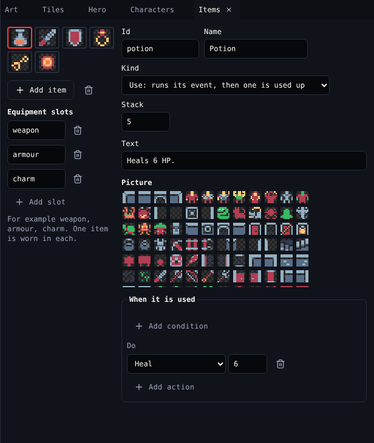

# Items

{ .shot }

Items lie in rooms until the hero picks them up with A, and then go in the bag
(**C** or the X button opens it while you play). **Add item** makes a new one;
the bin deletes the picked one, from rooms and drops too.

| Setting | Means |
|---|---|
| Id, Name | The id names it in the file; the name shows in the bag. |
| Kind | **Use** runs its event and is used up. **Equip** is worn in a slot for a bonus. **Key** and **Quest** do nothing alone; doors, events and quests check for them. |
| Stack | How many fit in one bag slot. Gear always takes one. |
| Text | A short line under the bag list. |
| Picture | Its picture in the bag and on the floor. |
| Slot, bonus | For gear: the slot it is worn in, and what it adds to MAX, ATK and DEF. |
| When it is used | For use items: an [event](../events.md), for example *Heal 6*. |

## Equipment slots

**Add slot** adds a slot, up to 8: for example weapon, armour, charm. One item
is worn in each. A slot that items use can't be deleted.

## Related

- [Chili RPG editor](../index.md)
- [All Chili RPG tools](index.md)
- [Lost Ring tutorial](../tutorial.md)
