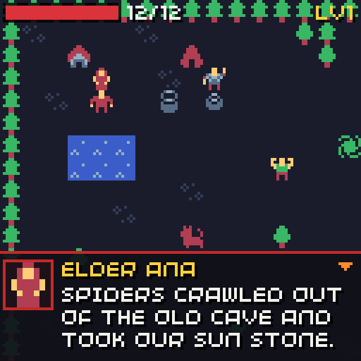

# Play

{ .shot }

Press **Play game**. **Restart with my changes** plays your latest edits from
the start. If the game has a mistake, Play says where, for example
`rooms[0].actors[0].kind: no kind "slime"`.

| Key | Button | Does |
|---|---|---|
| Arrows or WASD | D-pad | Walk. Walk into an enemy to fight it, into a friend to talk. |
| ++z++, ++space++ or ++enter++ | A | Talk, pick up, next line. |
| ++x++ | B | Wait a turn. |
| ++c++ or ++i++ | X | The bag. |
| ++v++ or ++q++ | Y | The quest log. |

Click the screen first so it gets the keys. The buttons under the screen work
on touch screens. The line under the screen shows the room and cell, HP, level,
quest stages and flags, so you can see why something happens.

Play uses the same engine as the platform and the console, so the game plays
the same everywhere. It always starts a new game; saves are for the console.

## Related

- [Chili RPG editor](../index.md)
- [All Chili RPG tools](index.md)
- [Lost Ring tutorial](../tutorial.md)
