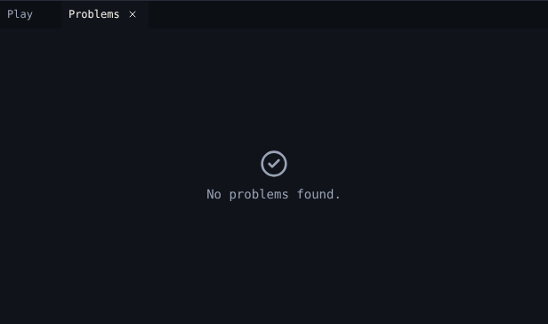

# Problems

{ .shot }

Problems checks the game as you work. The count shows at the bottom of the
creator.

| Kind | For example |
|---|---|
| Error | The start is in a wall; a room uses a tile that is gone; a character's dialogue is gone; a choice jumps to a line that is gone; a dialogue line has no text. |
| Warning | A tile or character uses a picture that is empty. |
| Note | A room can't be reached; nothing ends the game with a win yet. |

When something is gone, the message names it, for example
`Room "start" uses an item that is gone (gem).` [Play](rpg-play.md) checks
everything again in the engine.

## Related

- [Chili RPG editor](../index.md)
- [All Chili RPG tools](index.md)
- [Lost Ring tutorial](../tutorial.md)
