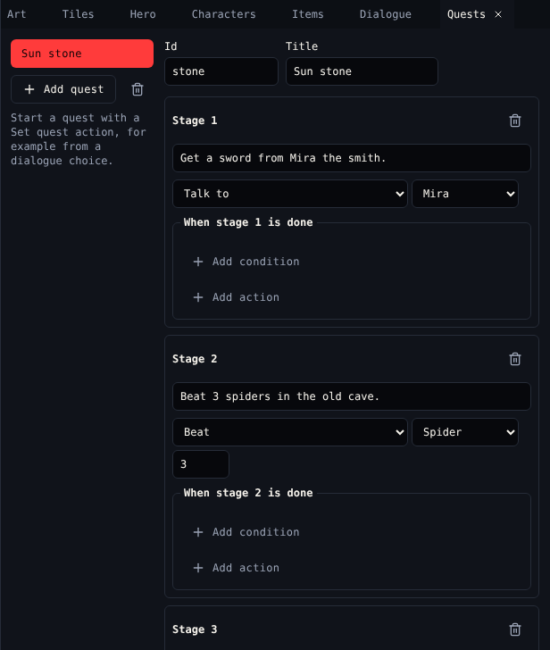

# Quests

{ .shot }

A quest has up to 8 stages. Press **Y** (or V on a keyboard) while you play to
see the quest log.

| Setting | Means |
|---|---|
| Id, Title | The id names it in the file; the title shows in the quest log. |
| Stage log | What the quest log says during the stage. |
| Goal | What finishes the stage, below. |
| When stage n is done | An [event](../events.md) that runs when the goal is met. |

| Goal | Met when |
|---|---|
| No goal | Never by itself. An event moves the quest on with *Set quest*. |
| Talk to | The hero talks to that character during the stage. |
| Have the item | The hero has that many of the item. |
| Beat | The hero beats that many of that enemy during the stage. |
| Reach a place | The hero stands on that room and cell. |
| Flag is on | The flag is on. |

A quest starts with the *Set quest* action at stage 1, for example from a
dialogue choice. When a stage's goal is met, its event runs and the next stage
starts. After the last stage the quest is done.

## Related

- [Chili RPG editor](../index.md)
- [All Chili RPG tools](index.md)
- [Lost Ring tutorial](../tutorial.md)
