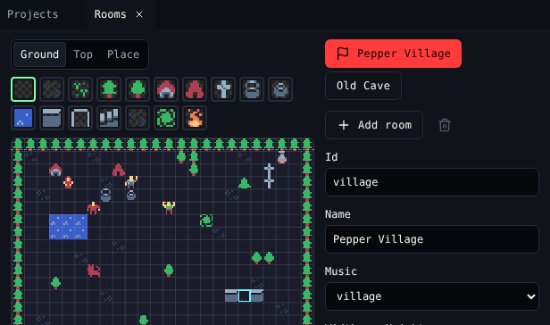
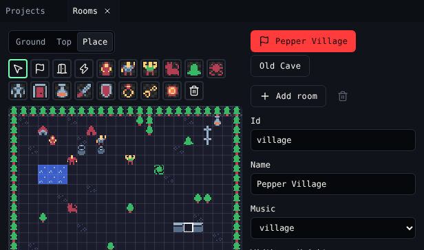

# Rooms

{ .shot }

The buttons at the top right pick a room. The flag marks the room the game
starts in. **Add room** adds a 16 × 16 room filled with the first tile.

## Layers and placing

| Mode | Click or drag to |
|---|---|
| **Ground** | Paint the picked tile. Every cell has a ground tile. |
| **Top** | Paint tiles drawn over people: roofs, tree tops, arches. **Empty** clears a cell. |
| **Place** | Put things on a cell, with the buttons below. |

| Place button | Puts |
|---|---|
| Pick | Nothing; shows what is on the cell, to change it. |
| Start (flag) | The hero's start. There is one start in the game. |
| Warp (door) | A warp. Stepping on it moves the hero to a room and cell you pick. Warps are drawn cyan. |
| Trigger (bolt) | A trigger. Stepping on it runs its [event](../events.md). Triggers are drawn yellow. |
| A character | One of the [characters](rpg-characters.md). |
| An item | An [item](rpg-items.md) lying on the floor. A picks it up. |
| Remove (bin) | Takes away what is placed on the cell. |

A character or an item takes the place of the one on the cell. After placing,
the cell's settings show on the right: where a warp goes, how many items lie
there, a trigger's event and **Only once**, and a patrolling character's
**Patrol points** (for example `6,10 16,10 16,14`).

{ .shot }

## Room settings

| Setting | Means |
|---|---|
| Id | The room's name in the file. Changing it changes the warps and quests that name it. |
| Name | Shown nowhere in the game yet; for you. |
| Music | A song from the file, when the game has songs. |
| Width, Height, Resize | 16 to 64 tiles each way. New cells get the first tile. People and things outside the new size are removed; the start and warps into the room move inside. |

The dashed line marks the top row: the HUD covers it when the view is at the
top of the room. A room bigger than 16 × 16 scrolls with the hero.

## Related

- [Chili RPG editor](../index.md)
- [All Chili RPG tools](index.md)
- [Lost Ring tutorial](../tutorial.md)
