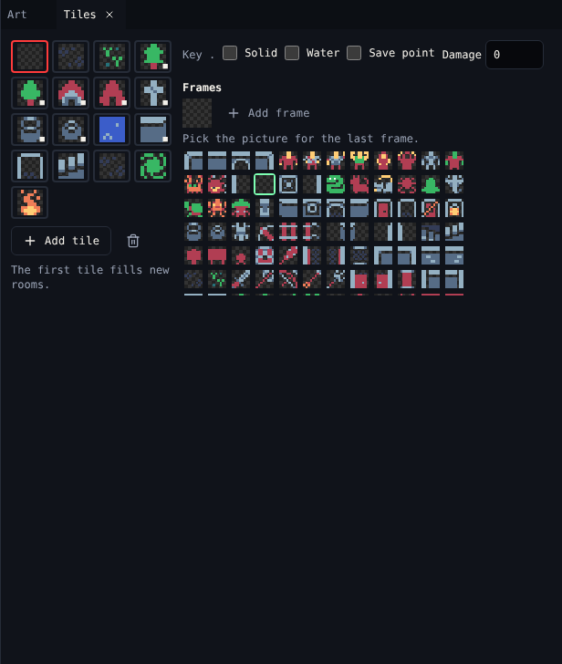

# Tiles

{ .shot }

A tile is a kind of ground. Rooms are painted with tiles, up to 90 of them.
**Add tile** makes one with the picture picked in [Art](rpg-art.md); the bin
deletes the picked tile, and the first tile takes its place in every room. The
first tile also fills new rooms.

| Setting | Means |
|---|---|
| Key | The character the tile uses in the file. |
| Solid | Blocks walking and sight: walls, trees. A small square marks it in the list. |
| Water | Blocks walking, not sight. |
| Save point | Saves the game when the hero steps on it. |
| Damage | Hurts whoever steps on it: fire, spikes. |
| Frames | Up to 4 pictures that take turns, each shown for **ms each** (400 by default). **Add frame**, then pick its picture. |

## Related

- [Chili RPG editor](../index.md)
- [All Chili RPG tools](index.md)
- [Lost Ring tutorial](../tutorial.md)
