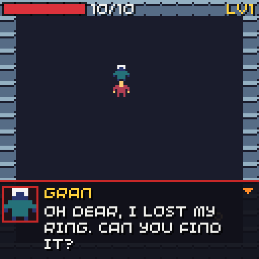

# Lost Ring tutorial

Gran has lost her ring. Talk to her, find the ring in the corner of the room,
and bring it back to win. It takes about 10 minutes and shows how pictures,
items, characters, dialogue and quests work together.

{ .shot }

| Part | What you make |
|---|---|
| Art | A ring and Gran |
| Items | The ring, a quest item |
| Characters | Gran, who talks |
| Quests | Lost ring: find the ring, then bring it to Gran |
| Dialogue | Three lines; each shows at one point of the quest |
| Rooms | Gran and the ring in the room |

## 1. Start a blank game

1. Open the creator and pick **Chili RPG**.
2. In **Projects**, press **New game**.
3. Type **Lost Ring** as the title, at the top.

The game has a hero in a walled 16 × 16 room. Press **Play game** in **Play**
and walk around with the arrow keys.

## 2. Draw the ring and Gran

Open **Art**. A blank game has three pictures: 0 is the clear floor, 1 the wall
and 2 the hero.

1. Press **Add picture**. Pick the yellow and draw a small ring in picture 3.
2. Press **Add picture** again. Draw Gran in picture 4: grey hair, a teal
   dress. Or press **Copy** on picture 2 and recolour the hero.

Clear pixels show the floor under them. See [Art](tools/rpg-art.md) for the
other drawing tools.

## 3. The ring item

Open **Items** and press **Add item**.

| Setting | Set it to |
|---|---|
| Id | `ring` |
| Name | Ring |
| Kind of item | **Quest: quests check for it** |
| Text | Gran's gold ring. |
| Picture | Picture 3 |

## 4. Gran

Open **Characters** and press **Add character**.

| Setting | Set it to |
|---|---|
| Id | `gran` |
| Name | Gran |
| Friendly | On |
| Picture | Picture 4 |

You give her a dialogue in step 6.

## 5. The quest

Open **Quests** and press **Add quest**. Set the **Id** to `ring` and the
**Title** to **Lost ring**.

1. **Stage 1.** Log: *Find Gran's ring.* Goal: **Have the item**, Ring, 1.
2. Press **Add stage**. **Stage 2.** Log: *Bring the ring to Gran.* Goal:
   **Talk to**, Gran.
3. Under **When stage 2 is done**, press **Add action** twice:
    - **Take item**, Ring, 1.
    - **End the game**, won.

Nothing starts the quest yet. Gran does that in her dialogue.

## 6. What Gran says

Open **Dialogue** and press **Add dialogue**. Set the **Id** to `gran` and the
**Speaker** to `gran`, so her name and picture show.

Write three lines. Press **Add line** for lines 2 and 3. Under each line,
**Show it only if, then do** holds the line's conditions and actions.

| Line | Text | Show it only if | Then do |
|---|---|---|---|
| 1 | Oh dear, I lost my ring. Can you find it? | Quest, Lost ring, **not started** | Set quest, Lost ring, **stage 1** |
| 2 | Did you look in the far corner? | Quest, Lost ring, **at stage 1** | |
| 3 | My ring! Thank you, dear. | Quest, Lost ring, **at stage 2** | |

Back in **Characters**, pick Gran and set her **Dialogue** to `gran`.

!!! tip "Why each line has a condition"
    Lines play from the top, and a line whose condition fails is skipped. So the
    same dialogue says the right thing at each point of the story. Line 1 starts
    the quest, so the next time you talk to her, line 2 shows instead.

## 7. Place Gran and the ring

Open **Rooms** and pick **Place**.

1. Pick Gran in the place buttons and click 3 cells above the hero.
2. Pick the Ring and click a cell in the far corner.

See [Rooms](tools/rpg-rooms.md) to paint more walls or add a second room.

## 8. Play and check

1. Open **Problems**. It should say **No problems found**. If a line names
   something gone, check the ids: `ring` and `gran` must match everywhere.
2. In **Play**, press **Play game**. Walk into Gran to talk, and press Z (the A
   button) to read on.
3. Press V (the Y button) to see the quest log.
4. Walk to the ring and press Z to pick it up. Press C (the X button) to see it
   in the bag.
5. Walk back into Gran. After her last line, the game ends with **THE END**.

When it plays well, press **Release** on its row in [Projects](../../get-started/projects.md),
so it plays on the platform and on the chilichip console.

## Ideas to try next

- Add a second room and a warp to it, and hide the ring there.
- Add a spider that guards the ring. Turn **Friendly** off, give it HP and
  **Drops** for the ring, and change stage 1's goal to **Beat**.
- Give the hero a choice: press **Add choice to line 1** and add *Yes* and *No*.
- Open **Pepper Village** in Projects to see a bigger game made the same way.

## Related

- [Chili RPG editor](index.md)
- [Events](events.md)
- [All Chili RPG tools](tools/index.md)
