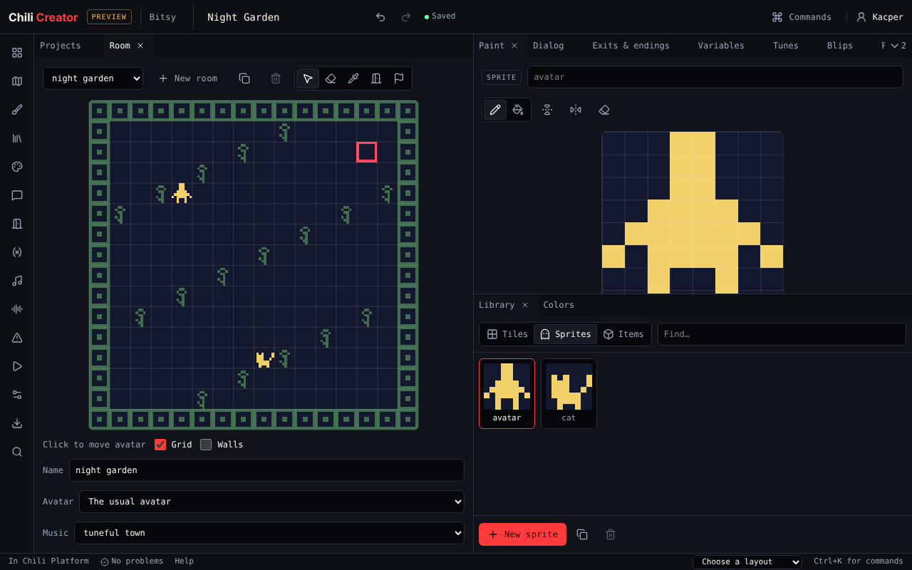
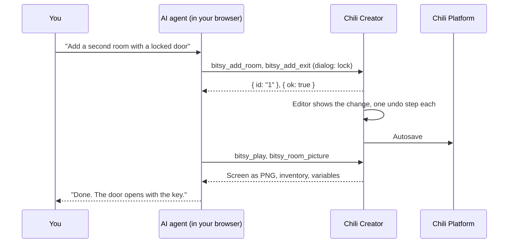
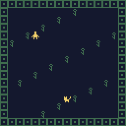

# Make games with AI

You can let an AI agent, like Claude, work on your games while you watch. You
ask in plain words: *"Make a night garden with glowing flowers and a cat who
asks for one."* The agent uses the creator's tools to build it, and every
change shows in the editor at once.

{ .shot }

The creator offers its tools to agents with **WebMCP**, a new web standard
([spec](https://webmachinelearning.github.io/webmcp/)). An agent that runs in
your browser finds the tools on the page and calls them. Nothing leaves your
browser except what the creator already sends to the platform when it saves.

!!! warning "Early days"
    WebMCP is new. Browsers and agents are still adding it. Today you need a
    browser with WebMCP turned on and an agent that can use a page's WebMCP
    tools. The creator works the same without it: it only offers its tools
    when the browser asks for them.

## How it works



- The agent calls **tools**. Each tool does one thing a person can do in the
  editor, with the same code the editor's own tools use.
- Each change is **one undo step**. Press Undo (Ctrl+Z) to take back what
  the agent did, or ask it to call `undo`.
- The agent **asks you first** before it releases or deletes a game. Your
  browser shows a yes or no box.
- The agent can **look** at its work: room and screen pictures, and the game
  played in the real engine (citsy for Bitsy, the Chili Beat engine for Chili
  Beat), the same engines the console uses.
- The usual limits stay: 30 games, 1.5 MB per game, and releasing needs you
  to be signed in with a verified email.

## Connect an agent

1. Open the creator from [Chili Platform](https://platform.chilichip.eu/creator),
   or on its own. Sign in if you want your games saved to the platform.
2. Use a browser with WebMCP. In Chrome Canary, open
   `chrome://flags/#enable-webmcp-testing`, set **WebMCP for testing** to
   **Enabled** and relaunch.
3. Start your agent in that tab. It should list tools like `creator_status`
   and `new_game`.
4. Ask it to start with `creator_status`. It tells the agent if you are signed
   in, which game is open, and which editors and templates there are.

To check that the page offers its tools, open DevTools on the creator's frame
and run:

```js
(document.modelContext ?? navigator.modelContext) !== undefined
```

!!! note "Inside the platform"
    On the platform the creator runs in a frame on the same site. WebMCP lets
    a page's own frames offer tools by default, so nothing else is needed.

## Example prompts

| You ask | The agent uses |
|---|---|
| "Make a new Bitsy game called Night Garden with a dark blue palette." | `new_game`, `bitsy_set_palette` |
| "Draw a glowing flower tile and scatter it around the first room." | `bitsy_add_drawing`, `bitsy_set_room`, `bitsy_room_picture` |
| "The cat should ask for a flower, and thank you when you have one." | `bitsy_set_dialog` with a condition on `{item "…"}` |
| "Add a second room behind a locked door." | `bitsy_add_room`, `bitsy_add_exit` with `dialog: "lock"` |
| "Write a slow, sleepy tune for the garden." | `bitsy_add_tune`, `bitsy_set_tune`, `bitsy_set_room` |
| "Play it and check you can reach the ending." | `bitsy_play`, `list_problems` |
| "Start a Chili Beat game from Bee Home and make the bees faster." | `new_game` with `template`, `beat_set_game` |
| "Add a rule: when you bump a coin, count 1 and play a coin sound." | `beat_add_sound`, `beat_add_counter`, `beat_add_rule` |
| "Release it." | `release_game` (you confirm first) |

Tips for good results:

- Say which editor you want. Bitsy is for stories with rooms and dialog;
  Chili Beat is for games where things move on the beat.
- Ask the agent to look at a picture or play the game after big changes.
- Ask it to check `list_problems` before it says it is done.
- If something goes wrong, say "undo that". Each change is one step.

## The tools

All tools answer with JSON. When a tool cannot do something, it answers with
a short error that says why, like `No room has id "7".` Tools marked
*reads only* change nothing.

### For every editor

| Tool | Does |
|---|---|
| `creator_status` | Start here. Signed in or not, games used of 30, the open game, undo and redo, editors and their templates. *Reads only.* |
| `list_projects` | Your projects and released games, for one editor or all. *Reads only.* |
| `open_project` | Opens a game. The editor switches to the game's editor. |
| `new_game` | Makes a game, blank or from a template, and opens it. |
| `import_game` | Makes a game from `.bitsy` text, a Bitsy web page or `.beat` text. |
| `copy_project` | Copies a game. |
| `delete_project` | Deletes a game for good. **Asks you first.** |
| `release_game` | Releases a game, or publishes a released game's changes. **Asks you first.** |
| `remove_cover` | Takes the cover off the open game. |
| `close_game` | Saves and closes the open game. |
| `set_title` | Changes the open game's title. |
| `get_game_text` | The whole game as file text. *Reads only.* |
| `set_game_text` | Replaces the whole game with new file text; refuses text that is not a game. |
| `undo` | Takes back the last change, the agent's or yours. |
| `redo` | Does an undone change again. |
| `list_problems` | What the [Problems](../editors/bitsy/tools/problems.md) tool shows. *Reads only.* |
| `download_game_file` | Your browser saves the `.bitsy` or `.beat` file. |

### Bitsy editor

Rooms are 16 × 16 cells. `x` is the column (0 to 15, left to right) and `y` the
row (0 to 15, top to bottom). Drawings are 8 × 8 pixels, written as 8 strings
of 8 digits: `1` is drawn, `0` is background. Sprite `A` is the avatar.

| Tool | Does | Same as |
|---|---|---|
| `bitsy_get_world` | A map of the game: settings, start, palettes, rooms, drawings, dialogs, variables, tunes and blips. *Reads only.* | |
| `bitsy_set_game` | Font, text direction, text size, or a custom `.bitsyfont`. | [Game](../editors/bitsy/tools/game.md) |
| `bitsy_add_palette` | Adds a palette, new or copied. | [Colors](../editors/bitsy/tools/colors.md) |
| `bitsy_set_palette` | Renames a palette or changes its colours (`#rrggbb`). | [Colors](../editors/bitsy/tools/colors.md) |
| `bitsy_remove_palette` | Removes a palette; its rooms take the first one. | [Colors](../editors/bitsy/tools/colors.md) |
| `bitsy_add_drawing` | Adds a tile, sprite or item, new or copied. | [Library](../editors/bitsy/tools/library.md) |
| `bitsy_get_drawing` | A drawing's pixels and settings. *Reads only.* | [Paint](../editors/bitsy/tools/paint.md) |
| `bitsy_set_drawing` | Name, pixels, second frame, wall, dialog and blip. | [Paint](../editors/bitsy/tools/paint.md) |
| `bitsy_paint` | Pencil, fill, flip or clear on one frame. | [Paint](../editors/bitsy/tools/paint.md) |
| `bitsy_remove_drawing` | Removes a drawing and its uses. | [Library](../editors/bitsy/tools/library.md) |
| `bitsy_add_room` | Adds a room, new or copied. | [Room](../editors/bitsy/tools/room.md) |
| `bitsy_get_room` | A room's tiles, items, sprites, exits and endings. *Reads only.* | [Room](../editors/bitsy/tools/room.md) |
| `bitsy_set_room` | Name, palette, tune, or all tiles at once. | [Room](../editors/bitsy/tools/room.md) |
| `bitsy_remove_room` | Removes a room. | [Room](../editors/bitsy/tools/room.md) |
| `bitsy_place` | Puts a tile, item or sprite on a cell; moves the avatar's start. | [Room](../editors/bitsy/tools/room.md) |
| `bitsy_erase` | Takes the top thing, or the exit or ending, off a cell. | [Room](../editors/bitsy/tools/room.md) |
| `bitsy_room_picture` | A PNG of a room. *Reads only.* | |
| `bitsy_set_cover` | Makes a room's picture the cover. | [Play](../editors/bitsy/tools/play.md) |
| `bitsy_add_exit` | An exit to another room: two-way, transition, lock or narration. | [Exits & endings](../editors/bitsy/tools/exits.md) |
| `bitsy_set_exit` | Changes an exit. | [Exits & endings](../editors/bitsy/tools/exits.md) |
| `bitsy_remove_exit` | Removes an exit and its way back. | [Exits & endings](../editors/bitsy/tools/exits.md) |
| `bitsy_add_ending` | An ending with its text. | [Exits & endings](../editors/bitsy/tools/exits.md) |
| `bitsy_remove_ending` | Removes an ending. | [Exits & endings](../editors/bitsy/tools/exits.md) |
| `bitsy_get_dialog` | The text of a dialog, ending, sprite or item. *Reads only.* | [Dialog](../editors/bitsy/tools/dialog.md) |
| `bitsy_set_dialog` | Writes dialog in [Bitsy script](../editors/bitsy/dialog-scripting.md). | [Dialog](../editors/bitsy/tools/dialog.md) |
| `bitsy_remove_dialog` | Removes a dialog. | [Dialog](../editors/bitsy/tools/dialog.md) |
| `bitsy_set_variable` | Adds a variable or sets its value. | [Variables](../editors/bitsy/tools/variables.md) |
| `bitsy_rename_variable` | Renames a variable, in dialog too. | [Variables](../editors/bitsy/tools/variables.md) |
| `bitsy_remove_variable` | Removes a variable. | [Variables](../editors/bitsy/tools/variables.md) |
| `bitsy_set_starting_item` | How many of an item the avatar starts with. | [Variables](../editors/bitsy/tools/variables.md) |
| `bitsy_get_tune` | A tune's key, tempo, instruments and notes. *Reads only.* | [Tunes](../editors/bitsy/tools/tunes.md) |
| `bitsy_add_tune` | Adds a tune, new or copied. | [Tunes](../editors/bitsy/tools/tunes.md) |
| `bitsy_set_tune` | Key, tempo, instruments, arpeggio, and all bars of notes. | [Tunes](../editors/bitsy/tools/tunes.md) |
| `bitsy_remove_tune` | Removes a tune. | [Tunes](../editors/bitsy/tools/tunes.md) |
| `bitsy_add_blip` | Makes a blip of a kind: pick up, greeting, magic… | [Blips](../editors/bitsy/tools/blips.md) |
| `bitsy_get_blip` | A blip's pitches and timing. *Reads only.* | [Blips](../editors/bitsy/tools/blips.md) |
| `bitsy_change_blip` | Make again, mutate, transpose, stretch, pace, instrument, repeat. | [Blips](../editors/bitsy/tools/blips.md) |
| `bitsy_remove_blip` | Removes a blip. | [Blips](../editors/bitsy/tools/blips.md) |
| `bitsy_find` | Finds things by name, id or a line of dialog. *Reads only.* | [Find](../editors/bitsy/tools/find.md) |
| `bitsy_where_used` | Where a drawing, room, dialog, variable, palette, tune or blip is used. *Reads only.* | [Find](../editors/bitsy/tools/find.md) |
| `bitsy_play` | Plays the game in citsy, presses buttons, sends back the screen and state. | [Play](../editors/bitsy/tools/play.md) |
| `bitsy_download_web_page` | Your browser saves a web page that plays the game. | [Download](../editors/bitsy/tools/download.md) |

This is what the agent sees when it calls `bitsy_room_picture` on the room
above:

{ .shot }

### Chili Beat editor

The game is the same JSON as a `.beat` file
([format](https://github.com/chili-chip/chili-beat/blob/main/docs/format.md)).
Screens are 16 × 16 cells of thing keys, `.` for empty. Things are 8 × 8
pixels in the game's 4 colours, written as 8 strings of 8 digits from `0` to
`3`. Rules are numbered from 1, as in the [Rules](../editors/beat/tools/beat-rules.md) tool.

| Tool | Does | Same as |
|---|---|---|
| `beat_get_game` | The whole game, with rules numbered. *Reads only.* | |
| `beat_set_game` | Author, 4 colours, tempo, beat or turns, start screen, seed. | [Game](../editors/beat/tools/beat-game.md) |
| `beat_add_counter` | Adds a counter, up to 4. | [Game](../editors/beat/tools/beat-game.md) |
| `beat_set_counter` | Name, icon and start value. | [Game](../editors/beat/tools/beat-game.md) |
| `beat_remove_counter` | Removes a counter. | [Game](../editors/beat/tools/beat-game.md) |
| `beat_add_thing` | Adds a thing with a picture. | [Things](../editors/beat/tools/beat-things.md) |
| `beat_set_thing` | Name, picture, "you", or its key. | [Things](../editors/beat/tools/beat-things.md) |
| `beat_remove_thing` | Removes a thing from the game and its screens. | [Things](../editors/beat/tools/beat-things.md) |
| `beat_add_screen` | Adds a screen on the world map. | [Screens](../editors/beat/tools/beat-screens.md) |
| `beat_set_screen` | All things, ground, tune, reset, map place or id. | [Screens](../editors/beat/tools/beat-screens.md) |
| `beat_paint` | Puts a thing on one cell, on things or ground. | [Screens](../editors/beat/tools/beat-screens.md) |
| `beat_remove_screen` | Removes a screen. | [Screens](../editors/beat/tools/beat-screens.md) |
| `beat_screen_picture` | A PNG of a screen. *Reads only.* | |
| `beat_set_cover` | Makes a screen's picture the cover. | |
| `beat_add_rule` | Adds a rule card. | [Rules](../editors/beat/tools/beat-rules.md) |
| `beat_set_rule` | Replaces a rule card. | [Rules](../editors/beat/tools/beat-rules.md) |
| `beat_move_rule` | Moves a rule card. | [Rules](../editors/beat/tools/beat-rules.md) |
| `beat_remove_rule` | Removes a rule card. | [Rules](../editors/beat/tools/beat-rules.md) |
| `beat_add_sound` | Adds a sound effect. | [Sounds](../editors/beat/tools/beat-sounds.md) |
| `beat_set_sound` | Changes or renames a sound effect. | [Sounds](../editors/beat/tools/beat-sounds.md) |
| `beat_remove_sound` | Removes a sound effect. | [Sounds](../editors/beat/tools/beat-sounds.md) |
| `beat_add_tune` | Adds a 16-step tune. | [Sounds](../editors/beat/tools/beat-sounds.md) |
| `beat_set_tune` | Scale, lead and beat, or renames it. | [Sounds](../editors/beat/tools/beat-sounds.md) |
| `beat_remove_tune` | Removes a tune. | [Sounds](../editors/beat/tools/beat-sounds.md) |
| `beat_play` | Checks the game in the engine, plays it with button presses, sends back the screen and state. | [Play](../editors/beat/tools/beat-play.md) |

A rule card as the agent writes it:

```json
{
  "when": { "bump": ["you", "c"] },
  "if": [{ "counter": "coins", "atMost": 9 }],
  "do": [{ "vanish": true, "who": "bumped" }, { "count": "coins", "add": 1 }, { "sound": "ding" }]
}
```

## What agents cannot do

Some things stay with you, on purpose or because they only make sense on the
screen:

| Not a tool | Why |
|---|---|
| Sign in or out | Your account stays yours. Sign in on the platform. |
| Record a GIF | It records what you play. Use [Play](../editors/bitsy/tools/play.md). |
| Change the layout, language or tour | They are about your screen, not the game. |
| List a game for sale | That is on the platform, not in the creator. |

## For developers

Each engine module lists its tools in `agentTools`, next to its editors. See
[Engines and editors](../develop/engines.md#agent-tools).
