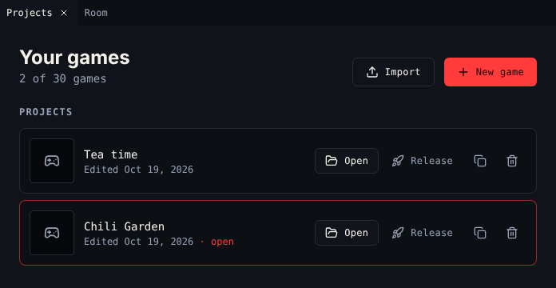

# Open the creator

The creator runs inside [Chili Platform](https://platform.chilichip.eu). Games you make there save to your account.

## 1. Make an account

1. [Create an account](https://platform.chilichip.eu/register) on Chili Platform.
2. Open the email we send you and verify your address.

!!! note "Why verify?"
    You can open the creator before you verify, but saving a game, releasing it and listing it all need a verified email address. See [Create an account and verify your email](https://platform.chilichip.eu/help/create-an-account).

## 2. Open the creator

Sign in and choose **Creator** in the platform menu, or go straight to [platform.chilichip.eu/creator](https://platform.chilichip.eu/creator).

The creator opens on **Projects**, the list of your games.

{ .shot }

## 3. Start a game

| You want to | Do this |
|---|---|
| Start from scratch | Choose **New game**. You get one room with walls, the avatar, a cat that talks, a cup of tea and a key. |
| Keep working on a game | Choose **Open** on it. |
| Bring in a game from the Bitsy editor | Choose **Import** and pick a `.bitsy` file, or a web page exported from Bitsy (`.html`). It becomes a new game. |
| Try something without changing a game | Choose **Duplicate** (the copy icon) and open the copy. |

You can keep 30 games on your account, released ones included. When you reach 30, delete a project to start a new one.

## How saving works

There is no save button. Every change saves to your account a moment after you make it.

The dot next to the game title shows the state:

| Dot | Means |
|---|---|
| Green, **Saved** | Your account has your latest change. |
| Amber, pulsing, **Saving…** | A change is on its way. |
| Red, with a message | The save failed. The creator tries again on your next change. |

If you try to leave the page while a change has not saved yet, the platform asks you first.

!!! tip "Keep your own copy"
    Use **Download → Download .bitsy** now and then. The `.bitsy` file is plain text, works in the [Bitsy editor](https://make.bitsy.org) too, and you can **Import** it again any time. See [Download](../tools/download.md).

### Not signed in

When the creator cannot reach your account, it says *Not signed in: games are saved in this browser only*. Your games then live in this browser. Sign in on Chili Platform to keep them on your account.

## Next

Find your way around in [The workspace](workspace.md).
