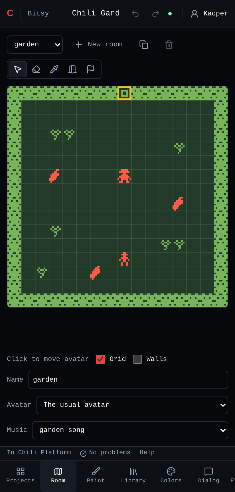
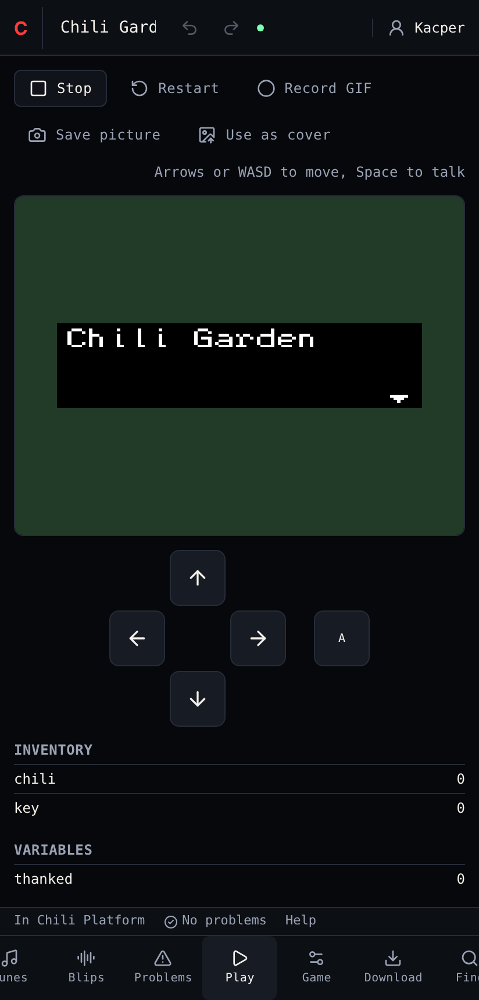

# On a phone

On a screen narrower than 640 pixels, the creator shows **one tool at a time**. Everything else works the same, and your game is the same game on every device.

| On a computer | On a phone |
|---|---|
| Tools dock side by side | One tool fills the screen |
| Tool bar on the left edge | Tool bar along the bottom. Slide it sideways to see all the tools of the editor. |
| Drag tabs to arrange | No arranging, no layouts |
| Arrow keys or WASD in Play | On-screen **Up**, **Down**, **Left**, **Right** and **Ok** buttons under the game |
| Click to draw | Tap or drag with a finger |

## Tips

- **Library, then Room.** Pick a tile in Library, then switch to Room and drag to draw. What you picked stays picked while you switch tools.
- **Help** is in the footer above the tool bar, like on a computer.
- The command palette needs a keyboard, so on a phone every command is a button in its tool.

## Next

Start a tutorial: [Chili Garden](../editors/bitsy/tutorial/index.md) in the Bitsy editor or [Bee Home](../editors/beat/tutorial.md) in the Chili Beat editor.
