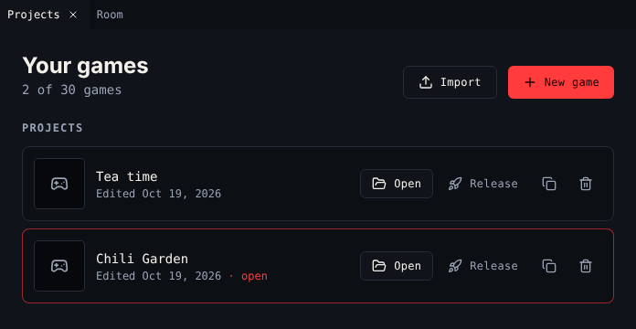
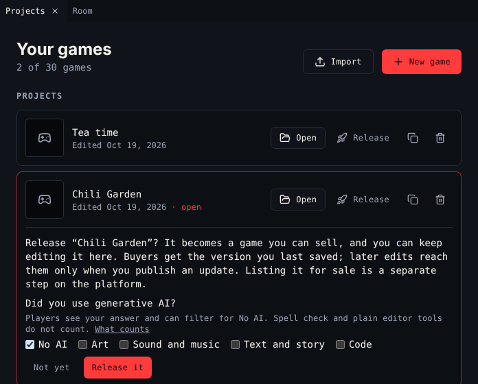

# Projects

**Projects** lists your games. It is the first thing you see when you open the creator.

{ .shot }

!!! note "One list per editor"
    Projects shows the games of the editor you are in. The 30-game limit counts
    the games of every editor together. Switch editors with **Change editor**,
    the editor's name at the top left.

## The list

The heading shows how many games you keep, out of 30. Each row has the game's cover, title and when you last edited it. The game you have open says **open**.

Below **Projects**, a **Released** section lists the games you released. *Buyers keep the version you released. Edits stay with you until you publish an update.*

## Buttons

| Button | Where | Does |
|---|---|---|
| **New game** | Top | Starts a blank game in the editor you are in. A blank Bitsy game has a room, the avatar, a cat, tea, a key, three tunes and two blips. Editors with example games list them under it, after **Or start from**. |
| **Import** | Top | Makes a new game from a `.bitsy` file or a web page exported from the Bitsy editor (`.bitsy`, `.txt`, `.html`) |
| **Open** | Each row | Opens the game in every tool |
| **Release** | Project rows | Turns the project into a game you can sell. Asks first, with the AI question. |
| **Duplicate** | Project rows | Copies the project. The copy is a new project. |
| **Delete** | Project rows | Deletes the project for good. Asks first: **Keep it** or **Delete for good**. |
| **Publish update** | Released rows | Sends your edits to players as the next release. Asks first. |
| **Game page** | Released rows | Opens the game's page on the platform |

## Release a game

{ .shot }

1. Choose **Release** on the project.
2. Answer **Did you use generative AI?**: tick what you made with it (**Art**, **Sound and music**, **Text and story**, **Code**), or **No AI**. Then choose **Release it**.
3. The game moves to **Released**. On the platform it is on the **My games** shelf of your [Library](https://platform.chilichip.eu/library).
4. To sell it, list it on the marketplace from your Library. See [List a game for sale](https://platform.chilichip.eu/help/sell-a-game).

Buyers get the version you last saved before releasing. Releasing needs a verified email address.

### The AI question

Players see your answer on the game's page, as **No AI** or, for example, **Made with AI: art, text**, and can filter the marketplace for games with no AI. Count anything a generative AI tool made or helped make, including a game made with an [AI agent](ai.md). Spell check and the creator's own drawing tools do not count. The platform's [AI use labels](https://platform.chilichip.eu/help/ai-use) article has the details, and the [seller terms](https://platform.chilichip.eu/seller-terms) ask you to answer honestly.

You answer once per game. Games you released before the question ask for it the next time you publish an update. To change the answer later, use the listing form on the platform.

## Publish an update

You can keep editing a released game. While your edits are not published, the top bar says **unpublished changes** next to the release number.

Choose **Publish update** on the game and **Publish it**. If the game has no AI answer yet, tick one first. Buyers, the platform's **Play** page and devices get the new version from then on.

## Limits

| Limit | Value |
|---|---|
| Games per account, released ones included | 30 |
| Size of one game | 1.5 MB |

When you reach 30, **New game**, **Import** and **Duplicate** are off. Delete a project to make room.

## Not signed in

Without an account, Projects says *Not signed in: games are saved in this browser only*. **Release** is not there. Sign in on Chili Platform to keep games on your account.

## Related

- [Open the creator](open-the-creator.md)
- [7. Test and release](../editors/bitsy/tutorial/7-test-and-release.md)
- [Download](../editors/bitsy/tools/download.md) for a copy of your game
