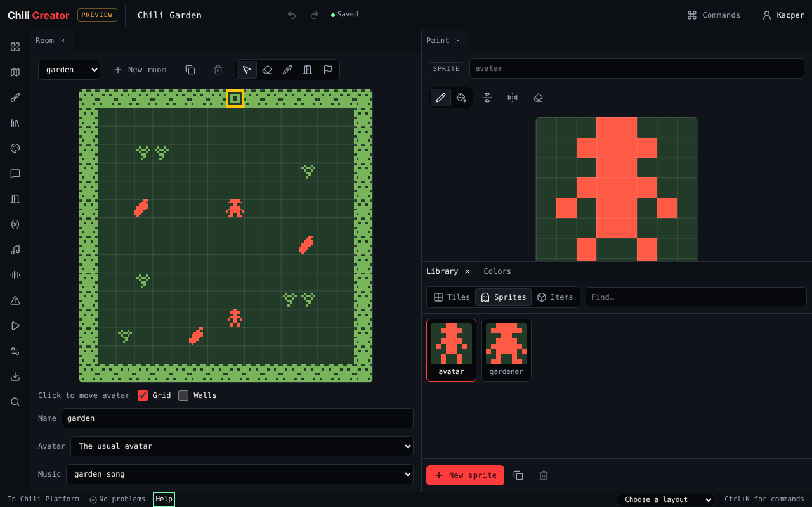
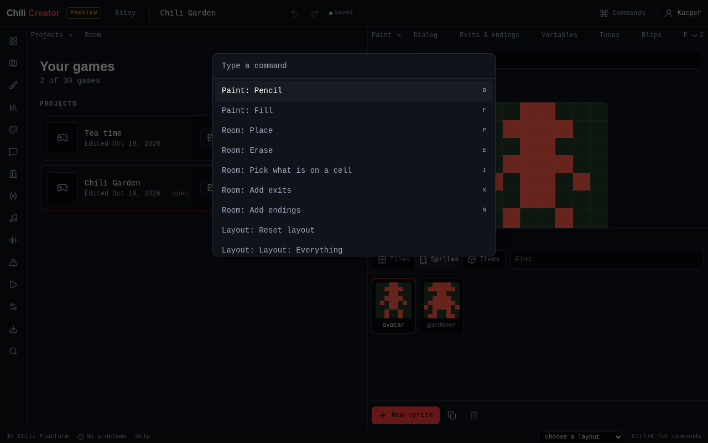
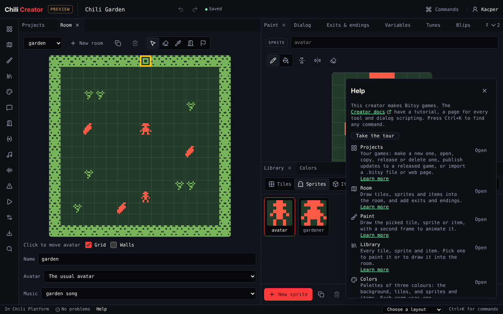
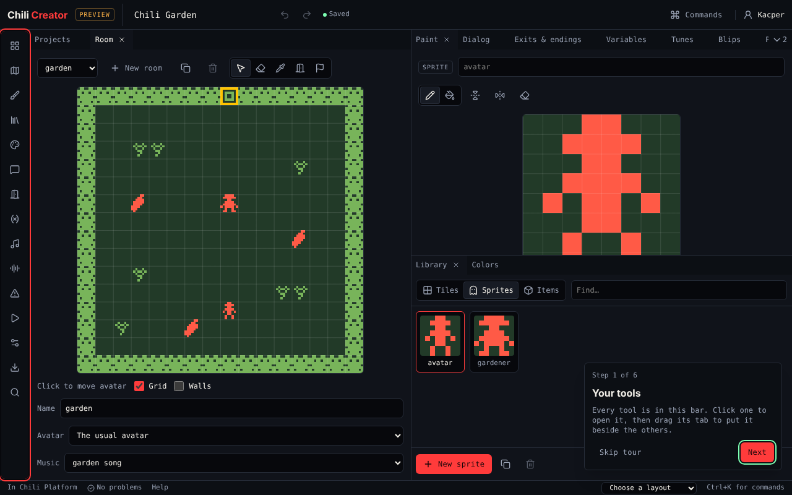

# The workspace

Everything in the creator is a **tool**. **Projects** is the same in every editor, and each [editor](../editors/index.md) adds its own tools: Room, Paint and Dialog in the Bitsy editor, Screens, Things and Rules in the Chili Beat editor, and so on. Tools open as tabs in a workspace that you arrange the way you like. Each editor remembers its own layout.

{ .shot }

| Part | Where | What it does |
|---|---|---|
| Top bar | Top | The game's title (click to rename), **Undo** and **Redo**, the save state, **Commands**, and your account |
| Tool bar | Left edge | One button per tool. Click one to open it or bring it to the front. |
| Workspace | Middle | The open tools, as tabs in groups. Drag a tab to move it beside, above or below another group. Drag the line between groups to resize them. |
| Footer | Bottom | Whether you are in Chili Platform, the number of [problems](../editors/bitsy/tools/problems.md), **Help**, the **Layout** menu, and a reminder of ++ctrl+k++ |

Your arrangement is remembered in this browser.

## The tools

These are the tools of the Bitsy editor. The Chili Beat editor's are listed in [Chili Beat tools](../editors/beat/tools/index.md).

| Icon order | Tool | For |
|---|---|---|
| 1 | [Projects](projects.md) | Your games: new, open, import, release |
| 2 | [Room](../editors/bitsy/tools/room.md) | Draw the room, place sprites and items, add exits and endings |
| 3 | [Paint](../editors/bitsy/tools/paint.md) | Draw a tile, sprite or item, and animate it |
| 4 | [Library](../editors/bitsy/tools/library.md) | Every tile, sprite and item; pick one to paint or place |
| 5 | [Colors](../editors/bitsy/tools/colors.md) | The palettes |
| 6 | [Dialog](../editors/bitsy/tools/dialog.md) | What sprites and items say |
| 7 | [Exits & endings](../editors/bitsy/tools/exits.md) | Where exits lead, locks, transitions, ending text |
| 8 | [Variables](../editors/bitsy/tools/variables.md) | Numbers and words the dialog remembers; starting items |
| 9 | [Tunes](../editors/bitsy/tools/tunes.md) | Music for rooms |
| 10 | [Blips](../editors/bitsy/tools/blips.md) | Short sounds for sprites and items |
| 11 | [Problems](../editors/bitsy/tools/problems.md) | Things that would break the game |
| 12 | [Play](../editors/bitsy/tools/play.md) | Play the game, record a GIF, set the cover |
| 13 | [Game](../editors/bitsy/tools/game.md) | Title, font, text direction and size, raw `.bitsy` text |
| 14 | [Download](../editors/bitsy/tools/download.md) | `.bitsy` file or a web page |
| 15 | [Find](../editors/bitsy/tools/find.md) | Search everything, see where a drawing is used |

## Layouts

The **Layout** menu in the footer sets the tools up for one kind of work. Choosing one replaces the current arrangement.

| Layout | Opens |
|---|---|
| Everything | Every tool, where it opens by default |
| Drawing | Room, with Paint beside it and Library and Colors below Paint |
| Writing | Room, with Dialog, Exits & endings and Variables beside it, and Play below |
| Sound | Room, with Tunes and Blips beside it |
| Playtest | Play, with Room beside it and Problems below |

{ .shot }

**Reset layout** in the command palette goes back to the default.

## The command palette

Press ++ctrl+k++ (++cmd+k++ on a Mac), or choose **Commands** in the top bar. Type a few letters and press ++enter++. Every tool, layout and editing command is there, with its key shortcut on the right.

{ .shot }

All shortcuts are listed in [Keyboard shortcuts](../reference/keyboard-shortcuts.md).

## Undo and redo

Every change can be undone, in every tool: ++ctrl+z++ to undo, ++ctrl+shift+z++ or ++ctrl+y++ to redo, or the arrows in the top bar. While you type in a text field, ++ctrl+z++ undoes your typing instead.

## Help and the tour

**Help** in the footer lists every tool with one line on what it is for, an **Open** button and a **Learn more** link to its page here.

{ .shot }

The first time you open the creator, a six-step tour shows the tool bar, Projects, Room, Paint, Play, and the commands and layouts. You can try each tool while the tour explains it. **Skip tour** closes it. Start it again with **Take the tour** in Help or in the command palette.

{ .shot }

## Next

On a phone? Read [On a phone](phone.md). Otherwise start the [tutorial](../editors/bitsy/tutorial/index.md).
