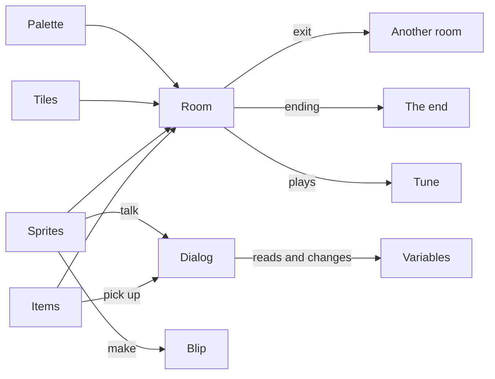

# Chili Creator docs

The **Chili Creator** makes small adventure games in your browser. You paint rooms out of 8×8 pixel tiles, put characters and items in them, write what they say, and link rooms with exits. There is no code to write.

Games are [Bitsy](https://bitsy.org) games. They play in the browser, on [Chili Platform](https://platform.chilichip.eu), as a web page you can put anywhere, and on the **VGC Zero** handheld.

{ .shot }

-   :material-rocket-launch: **[Get started](get-started/index.md)**

    Open the creator, find your way around the workspace, and use it on a phone.

-   :material-school: **[Tutorial](tutorial/index.md)**

    Build *Chili Garden*, a two-room game with a quest, a locked gate and an ending, in seven short steps.

-   :material-toolbox: **[Tools](tools/index.md)**

    One page for each of the 15 tools: Room, Paint, Dialog, Tunes, Play and the rest.

-   :material-book-open-variant: **[Reference](reference/index.md)**

    Dialog scripting, keyboard shortcuts, playing on VGC Zero and how the creator differs from Bitsy.

## Make your first game in five minutes

1. Open the [Creator](https://platform.chilichip.eu/creator) on Chili Platform and sign in.
2. In **Projects**, choose **New game**. A new game has one room, an avatar, a cat and two items.
3. In **Library**, pick a tile, then click in the **Room** to draw walls.
4. Pick the cat in **Library** and open **Dialog**. Write what the cat says.
5. Open **Play** and choose **Play game**. Walk with the arrow keys and bump into the cat.

Your game saves itself while you work. When you want more, follow the [tutorial](tutorial/index.md).

## How a game fits together

| Part | What it is | Tool |
|---|---|---|
| Room | 16×16 tiles, the size of one screen | [Room](tools/room.md) |
| Tile | An 8×8 drawing for the floor and walls. Walls stop the avatar. | [Paint](tools/paint.md), [Library](tools/library.md) |
| Sprite | A character. The **avatar** is the sprite the player moves. | [Paint](tools/paint.md), [Library](tools/library.md) |
| Item | Something the avatar picks up and carries | [Paint](tools/paint.md), [Library](tools/library.md) |
| Palette | Three colours: background, tiles, sprites and items | [Colors](tools/colors.md) |
| Dialog | What sprites and items say, with choices and actions | [Dialog](tools/dialog.md) |
| Exit, ending | A cell that takes the avatar to another room, or ends the game | [Exits & endings](tools/exits.md) |
| Variable | A number or word that dialog remembers | [Variables](tools/variables.md) |
| Tune, blip | Music for a room, short sounds for sprites and items | [Tunes](tools/tunes.md), [Blips](tools/blips.md) |

## Where the creator lives

| Place | What you get |
|---|---|
| [platform.chilichip.eu/creator](https://platform.chilichip.eu/creator) | The creator, saving to your Chili account |
| [Chili Platform marketplace](https://platform.chilichip.eu/marketplace) | Games people released and listed |
| [VGC Zero](reference/vgc-zero.md) | The handheld plays `.bitsy` files with citsy |
| [chili-chip/chili-creator](https://github.com/chili-chip/chili-creator) | Source code, MIT licensed |

Questions or ideas? Ask on [Discord](https://discord.gg/xB9sPYKBZc) or in the [platform forum](https://platform.chilichip.eu/community).
