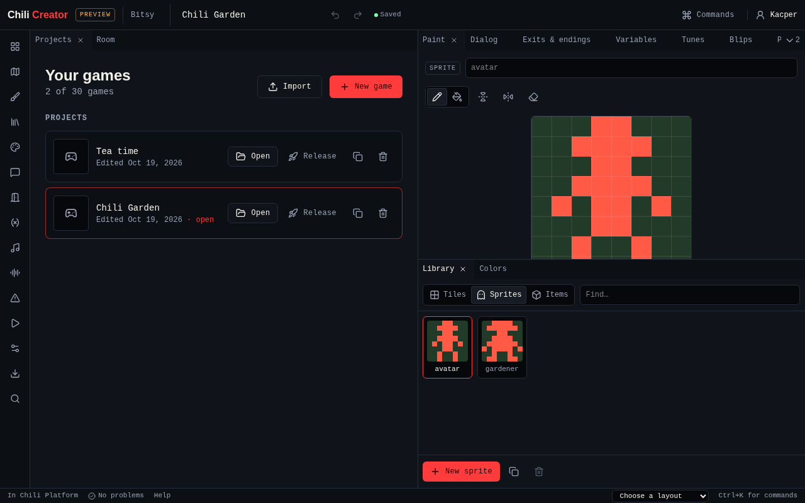
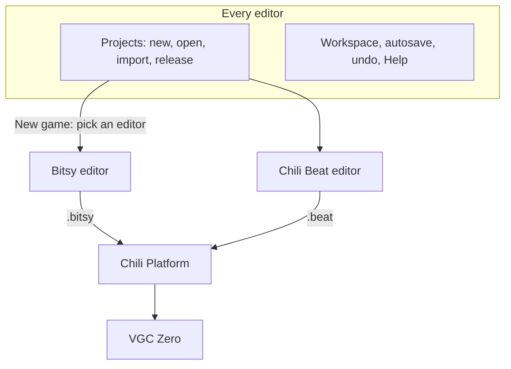

# Chili Creator docs

The **Chili Creator** is a collection of game editors in your browser. Each
editor makes one kind of game, with no code to write. Every editor shares the
same workspace: projects, autosave, undo, layouts, Play and Help.

| Editor | Makes | Start with |
|---|---|---|
| [**Bitsy editor**](editors/bitsy/index.md) | Story games: rooms of 8×8 tiles, characters to talk to, items, exits and endings. Games are [Bitsy](https://bitsy.org) games. | [Chili Garden tutorial](editors/bitsy/tutorial/index.md) |
| [**Chili Beat editor**](editors/beat/index.md) | Games where things bump, move and change on the beat. Rules are cards you build from pictures. | [Bee Home tutorial](editors/beat/tutorial.md) |

Games play in the browser, on [Chili Platform](https://platform.chilichip.eu),
and on the **VGC Zero** handheld. Bitsy games also export as a web page you can
put anywhere.

{ .shot }

-   :material-rocket-launch: **[Get started](get-started/index.md)**

    Open the creator, start a game in the editor you want, find your way around the workspace, and use it on a phone.

-   :material-puzzle: **[Bitsy editor](editors/bitsy/index.md)**

    The Chili Garden tutorial, a page for each of its 14 tools, dialog scripting and differences from Bitsy.

-   :material-music: **[Chili Beat editor](editors/beat/index.md)**

    The Bee Home tutorial, a page for each of its 7 tools, and rule recipes.

-   :material-book-open-variant: **[Reference](reference/index.md)**

    Keyboard shortcuts, playing on VGC Zero, the FAQ and credits.

## How the creator fits together

A game always opens in the editor that made it. **New game** asks which editor
you want, and offers each editor's example games.

## Where the creator lives

| Place | What you get |
|---|---|
| [platform.chilichip.eu/creator](https://platform.chilichip.eu/creator) | The creator, saving to your Chili account |
| [Chili Platform marketplace](https://platform.chilichip.eu/marketplace) | Games people released and listed |
| [VGC Zero](reference/vgc-zero.md) | The handheld plays `.bitsy` games with citsy and `.beat` games with Chili Beat |
| [chili-chip/chili-creator](https://github.com/chili-chip/chili-creator) | Source code, MIT licensed |

Questions or ideas? Ask on [Discord](https://discord.gg/xB9sPYKBZc) or in the [platform forum](https://platform.chilichip.eu/community).
