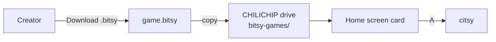

# Play on VGC Zero

The VGC Zero plays `.bitsy` games with **citsy**, the same engine the creator uses in [Play](../editors/bitsy/tools/play.md). A game that plays in the creator plays on the console.

## Put a game on the console

1. In the creator, open [Download](../editors/bitsy/tools/download.md) and choose **Download .bitsy**.
2. Turn the console on and wait for the home screen.
3. Plug it into your computer with a USB cable. A drive named **CHILICHIP** appears.
4. Copy the `.bitsy` file into the `bitsy-games` folder on the drive. Any folder at the top of the drive, or the top of the drive itself, works too.
5. Eject the drive.

The game shows on the home screen as a card with its file name. Pick it and press **A**.

!!! tip "Copy files while the home screen shows"
    While a game runs, the drive is read-only to your computer. Go back to the home screen first.

!!! note "citsy must be installed"
    citsy comes on the console. If no game cards show up, install it: download `citsy-32blit.blit` from the [citsy-32blit releases](https://github.com/chili-chip/citsy-32blit/releases), copy it to the top of the CHILICHIP drive and eject. It shows as **Bitsy** under **Settings → Installed software**, not on the home screen.

## Buttons

| Button | In a game |
|---|---|
| D-pad | Walk |
| **A** | Talk, next page of dialog, choose |
| **B** | Back, cancel |
| **MENU** | Pause: **Resume**, **Restart**, **Exit** |
| **HOME** | System menu: volume and brightness. Hold it to go home. |

**Exit** in the pause menu goes back to the home screen. After an ending, the next button press starts the game again from its title, as in Bitsy.

## What looks different

The console has a 128×128 screen, the same size as a Bitsy room. Dialog uses a box of three lines, so text can break into pages at other places than in the Bitsy editor. See [Differences from Bitsy](../editors/bitsy/differences.md).

## More

- [citsy-32blit](https://github.com/chili-chip/citsy-32blit): the console player, with build steps
- [citsy](https://github.com/chili-chip/citsy): the engine

## Chili Beat games

Chili Beat games play on the console with **Chili Beat**, the same engine as
[Play](../editors/beat/tools/beat-play.md) in the creator.

1. The player comes with the console. If `.beat` games don't show up, install
   it: download `chili-beat.blit` from the
   [chili-beat releases](https://github.com/chili-chip/chili-beat/releases),
   copy it to the top of the CHILICHIP drive and eject.
2. Copy `.beat` games anywhere on the drive. Each one shows up on the home
   screen as a game.

Games you own or bought on Chili Platform reach the console through device
sync, as `.bitsy` or `.beat` files to match their editor. On the console, the
D-pad moves, A and B are A and B, and MENU opens the system menu.
