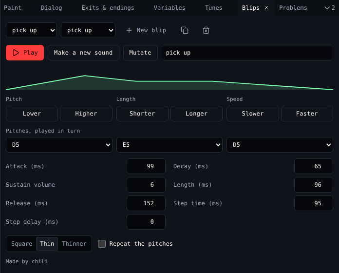

# Blips

A **blip** is a short sound a sprite or item plays when the avatar meets it. **Blips** makes them: pick a kind, make one, then mutate or tweak it until it sounds right.

{ .shot }

## Make one

1. Pick a **Kind**: pick up, greeting, bloop, bleep, magic, meow or random.
2. Choose **New blip**.
3. **Play** it. Not quite? **Make a new sound** makes another of the same kind; **Mutate** changes it a little.
4. Give it a name.
5. Pick it in **Sound** in [Paint](paint.md) for a sprite or item.

## Tweak it

| Control | Does |
|---|---|
| **Pitch**: Lower, Higher | Moves every pitch down or up |
| **Length**: Shorter, Longer | Shortens or lengthens it |
| **Speed**: Slower, Faster | Plays the pitches slower or faster |
| Pitches, played in turn | Up to three notes, played one after another |
| Attack, Decay, Length, Release (ms) | How the volume rises and falls. The shape above shows it. |
| Sustain volume | How loud it holds, 0 to 15 |
| Step time, Step delay (ms) | How long each pitch plays, and the gap before the next |
| Tone | Square, Thin or Thinner |
| **Repeat the pitches** | Keeps cycling through the pitches for the whole length |

The bottom says who makes the sound, like *Made by chili*.

## Related

- [Tunes](tunes.md) can play blips on a beat
- Dialog's **Play a blip** (`{blip "1"}`)
