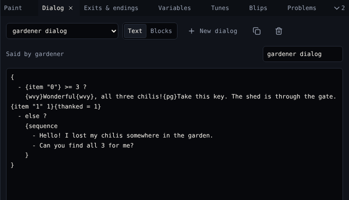
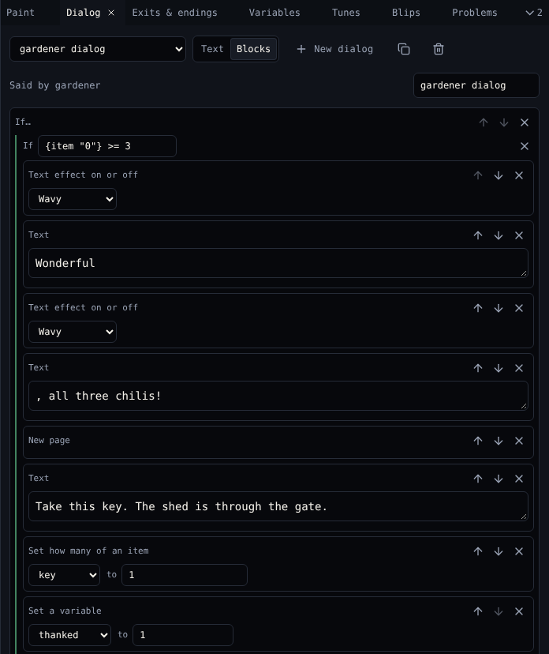

# Dialog

**Dialog** is what sprites and items say, and the text of endings and exits. Pick a sprite or item and Dialog shows its dialog. Write it as **Text**, or build it from **Blocks**.

{ .shot }

## Pick a dialog

| You picked | Dialog shows |
|---|---|
| A sprite or item with dialog | Its dialog, with *Said by …* |
| A sprite or item without dialog | **Write what … says**, which makes one |
| A tile | *Tiles do not talk* |
| Nothing | The dialog menu: pick any dialog |

| Control | Does |
|---|---|
| Dialog menu | Opens any dialog in the game, including exit and ending text |
| **Text**, **Blocks** | Switches view. Both edit the same dialog. |
| **New dialog** | Makes an empty dialog nobody says yet |
| **Copy dialog** | Copies this dialog |
| **Delete dialog** | Deletes it after asking. Whoever said it has nothing to say. |
| Name | The dialog's name in menus |

## Text view

Type the text. Long text is split into pages of three lines; the player presses a button to go on.

**Insert…** puts a ready-made piece of script at the cursor, or around the words you selected:

| Insert | Writes |
|---|---|
| Wavy text, Shaky text, Rainbow text | `{wvy}…{wvy}`, `{shk}…{shk}`, `{rbw}…{rbw}` |
| New page | `{pg}` |
| Say lines in order | `{sequence …}`: each line once, then the last one again |
| Say lines round and round | `{cycle …}`: the lines in turn, forever |
| Say lines in any order | `{shuffle …}`: a random line each time |
| If a variable is… | A branch on a [variable](variables.md) |
| If the player has an item | A branch on an item count |
| Change a variable, Show a variable | `{a = a + 1}`, `{say a}` |
| Go to a room | `{exit "0" 8 8}` |
| End the game | `{end}` |
| …and every block below | |

The full language is in [Dialog scripting](../reference/dialog-scripting.md).

## Blocks view

Each part of the dialog is a block with its own fields. Move blocks with the arrows, remove them with **×**, and add more from the **Add a block** menu. Choice blocks have **Add option**, and If blocks **Add a condition** and **Add otherwise**.

{ .shot }

| Group | Blocks |
|---|---|
| Dialog | Text, New page, Wavy, Shaky, Rainbow, Colour 1, Colour 2 and Colour 3 text, Draw a tile, Draw a sprite, Draw an item |
| Choices | Say lines in order, Say lines round and round, Say lines in any order, If a variable is…, If the player has an item |
| Exits and endings | Go to a room, End the game, Lock or unlock the exit |
| Room and sound | Change the palette, Change the avatar, Play a blip, Play a tune |
| Items and variables | Set how many of an item, One more of an item, One less of an item, Show how many of an item, Set a variable, Change a variable, Show a variable |

Fields that name something, like a room or an item, are menus of names, so you never type an id.

## Problems in a dialog

When a script refers to something that is not there, like a room you deleted or a variable nothing sets, Dialog lists the problem in amber under the text. See [Problems](problems.md).

## Related

- [4. Dialog](../tutorial/4-dialog.md) in the tutorial
- [Dialog scripting](../reference/dialog-scripting.md)
- [Exits & endings](exits.md) for exit and ending text
