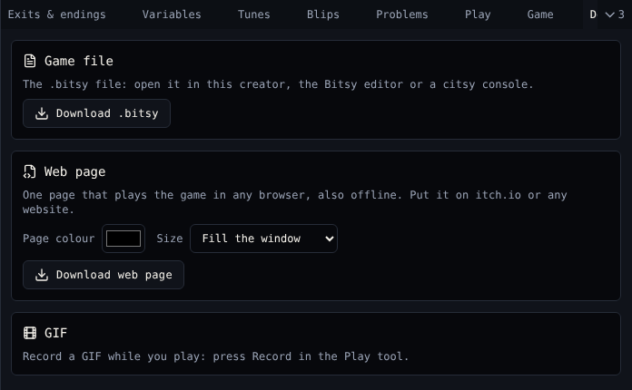

# Download

**Download** saves your game to your computer.

{ .shot }

## Game file

**Download .bitsy** saves the game as a `.bitsy` file. It is plain text. Open it in:

- this creator, with **Import** in [Projects](projects.md);
- the [Bitsy editor](https://make.bitsy.org);
- citsy on [VGC Zero](../reference/vgc-zero.md).

Download one now and then as your own backup.

## Web page

**Download web page** makes one `.html` file that plays the game in any browser, also offline. Put it on [itch.io](https://itch.io) or any website.

| Control | Does |
|---|---|
| **Page colour** | The colour around the game |
| **Size** | Fill the window, 256, 512 or 1024 pixels, or Other size |

The page carries citsy inside it and the citsy and Bitsy licence notices in a comment at the top.

## GIF

GIFs are recorded while you play: **Record GIF** in [Play](play.md).

## Related

- [Projects](projects.md) to release on Chili Platform instead
