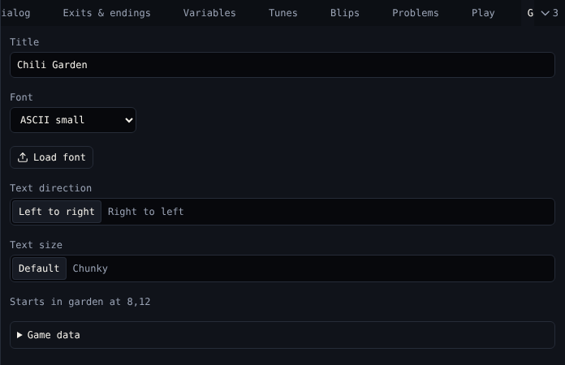

# Game

**Game** holds settings for the whole game.

{ .shot }

| Control | Does |
|---|---|
| **Title** | The game's title, the first text the player sees. The same as the title in the top bar. |
| **Font** | ASCII small, European small, European large, or a font you loaded |
| **Load font** | Loads a `.bitsyfont` file and uses it |
| **Save font** | Downloads the loaded font |
| **Text direction** | Left to right, or Right to left for languages like Arabic and Hebrew |
| **Text size** | Default, or Chunky for bigger letters |
| *Starts in …* | Where the avatar starts. Move it in [Room](room.md). |

!!! note "Fonts on VGC Zero"
    The console draws text in its own low-resolution font, whatever font you choose. See [Differences from Bitsy](../reference/differences.md).

## Game data

Open **Game data** to see the whole game as `.bitsy` text. You can edit it and choose **Apply game data**. If a line cannot be read, its line number and the reason show under the box.

*Changes here can break the game; Undo brings it back.* Use it for things no tool covers yet.

## Related

- [Download](download.md) to save the `.bitsy` file
